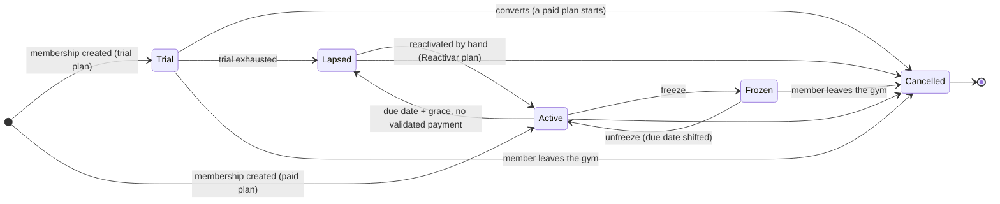
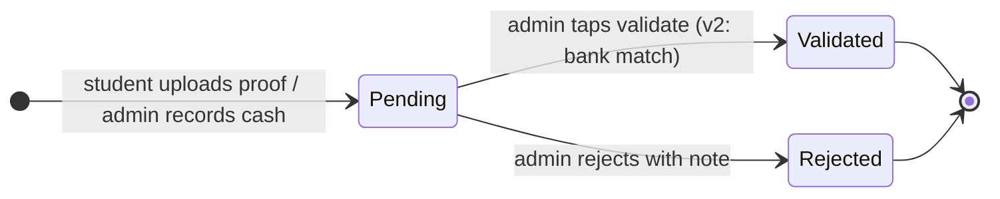
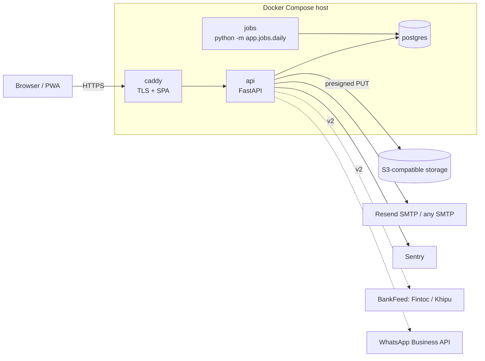

# Rakin — Technical design

> Scope and personas live in [product.md](product.md); screens in [design/ui-design.html](design/ui-design.html).

## Sport-agnostic design

Three configuration surfaces absorb all sport variance; the rest of the system is identical for a BJJ academy, a football school, a swimming club or a chess club. All three live as JSON in `gym.settings` (definitions) and as rows (values).

**Activities** — what a gym teaches (#245): one or more `gym_activity` rows, from the presets Ajustes › Gimnasio offers (BJJ, Judo, Ballet, Piano, Escalada, …) or named by the gym, each with `uses_grades`. Belts and ranks show only while one of the gym's activities uses grades (`uses_grades` on `/api/me/role`): with none, Ajustes › Graduación, the belt filters in Alumnos and the group builder, the rank on the ficha, the class roster and `/me`, and promotions are all hidden, though the API still serves them. A class type may belong to an activity. A new gym's Hoy checklist asks for its activities first.

**Vocabulary** — what the gym calls itself, its members and its coach (#344): `gym.settings.vocabulary` holds three keys from fixed lists (`app.domain.vocabulary`): `place` (academia, club, gimnasio, centro, escuela, dojo), `members` (alumnos, socios, deportistas, miembros) and `coach` (profe, sensei, coach, entrenador, instructor, profesor). The SPA keeps each option's singular, plural and gender (`frontend/src/i18n/vocabulary.ts`), and every string in `es.ts` that names the gym, its members or its coach reads them, with its articles and agreement. They are served on `/api/me/role`, `/api/host`, the join form and the privacy notice; a gym with none reads today's words, academia / alumnos / profe. Each activity preset carries a sport's words, and its key is stored on the activity (`gym_activity.preset`, migration 0059). The gym's first activity sets the words (its preset's, or gimnasio / miembros / coach for a free name, `by_hand: false`), unless the owner already picked them in Ajustes › Gimnasio (`by_hand: true`). After that nothing changes them on its own: Ajustes offers another activity's words as a one-tap suggestion. Outside the screens (#345) the backend holds the same forms (`vocabulary.Words`): the emails read them as `words` ("habla con el club", "en su lista de socios"), the unsubscribe page names the gym by its word, the ledger export heads its member column "Alumno" or "Socio", and the import template names its people's tab, its "Alumno desde" header, its instructions and its file by the members' word. The importer takes every option's tab name and headers, so a sheet with today's Alumnos headers still imports in a gym of socios. Routes and API names keep "alumnos".

**Grading scheme** — optional, and one per gym, shared by every activity that uses grades (Graduación says so when there are two or more): a gym with no ranks (the `none` preset, and what `app.gyms create` gives a new gym unless `--grading` names a preset, which also gives it one graded activity) shows no belt, rank or "Registrar graduación" anywhere, the ficha, the class roster, `/me`, Hoy and the setup checklist alike. An ordered list of ranks, each with optional sub-ranks, plus an optional separate kids ladder. Promotion events reference rank and sub-rank by key. A rank may carry its belt's colours (one, or two for a two-tone belt); such a rank is drawn as a belt, its stripes counted by the sub-rank's place after the first, and one without colours shows as its label. A scheme no rank of which has colours is levels (#353): the Alumnos and Grupos filters say "Nivel", the Graduación editor speaks of niveles and subniveles with no belt, and the import's Sub-grado note names a sub-rank, not a stripe. The `levels` preset ("Niveles") is that scheme, an empty list to fill; the martial arts' presets carry their belts' and arm bands' colours, so they read as belts: BJJ, judo, karate (a generic ladder and one each for Shotokan, Kyokushin and Goju-ryu, #411), taekwondo, kenpo, aikido and muay thai. Each is a common ladder for its art; federations and schools differ, and the gym edits its copy. A scheme never set up (no ranks saved) reads as belts in Graduación when a graded activity's preset has a grading preset with colours (`vocabulary.DEFAULT_GRADING` and the SPA's `GRADING_PRESET_OF`: karate reads by the generic ladder, its styles offered beside it), and as levels otherwise. The old `judo-karate` key, one ladder for both, is an alias for `judo` (`grading.ALIASES`): only `app.gyms create` and the panel ever took a key, and a gym stores its scheme's copy, never the key.

| Sport | Ranks | Sub-ranks | Kids ladder | Goal metric |
| --- | --- | --- | --- | --- |
| BJJ | white, blue, purple, brown, black | 0–4 stripes | grey, yellow, orange, green (with white/solid/black variants) | classes since last promotion |
| Judo | kyu 6→1 (white to brown), dan 1→10 | none | same ladder, slower | time in rank |
| Karate | kyu 10→1, dan 1→10; Shotokan (JKA) kyu 9→1, Kyokushin (IKO) mukyu and kyu 10→1 with stripes, Goju-ryu kyu 10→1 | none | same ladder, slower | time in rank |
| Taekwondo (WT) | gup 10→1 (white to red, tipped steps between), dan 1→9 | none | same ladder, slower | time in rank |
| Kenpo (American) | white, yellow, orange, purple, blue, green, brown 3→1, black 1→10 | none | same ladder, slower | time in rank |
| Aikido (Aikikai) | kyu 6→1 in white, dan 1→8 | none | same ladder, slower | time in rank |
| Muay Thai | none, or prajioud arm-band colours | none | none | none |
| Boxing / MMA | none | none | none | none |

**Plan types** — one enum, six kinds, parameters per kind.

| Kind | Parameters | Billing behaviour |
| --- | --- | --- |
| monthly | price, anchor (signup day or 1st) | charge each period; freeze shifts next due date |
| prepaid | price, period\_months | one charge, membership valid for N months |
| fixed\_period | price, period\_start, period\_end | one charge for the gym's dates, the same for every member, due on period\_start or the member's start if later, at the full price; never renews: "Duplicar para el próximo período" copies the plan with the next dates and moves its members across by a plan change; once period\_end has passed, no member starts, changes to, is imported onto or is reactivated on it |
| credits | price, credits, credit\_expiry\_days | one charge; each attendance decrements; lapsed at 0 or expiry |
| dropin | price | one charge, one attendance: a visit is a one-day membership, Cancelled as it is written ([ADR 0002](adr/0002-drop-in-visits.md)) |
| trial | free\_classes or free\_days | zero charge; converts or lapses |

**Custom fields** — per-gym definitions `{key, label, type, options?, sensitive?, visible_to}`; values stored per person per gym. Weight, competition record, insurance number, federation ID, emergency contact. `visible_to` (`owner`, `admin` or `staff`) is who among the staff sees the field, set by the owner only. Fields marked `sensitive` start as `owner`, are encrypted at rest and excluded from exports unless explicitly included (see Compliance).

The class vocabulary is defaults a gym edits, not assumptions: block kinds (Calentamiento, Técnica, Drilling, Juegos, Sparring, Otro) are renamed, archived or added in Ajustes › Bloques, and "open mat" is a class-type kind a gym need not use. Sparring blocks, run in rounds by the coach's timer, are only there for a gym that marks a kind as sparring. The sparring block is each gym's free practice (#346, `app.domain.practice`): every activity preset names it and the open mat made of it (BJJ: Sparring and Open mat; Judo: Randori; Escalada: Escalada libre; Remo: Remo libre; Natación: Nado libre; Fútbol: Partido; no preset: Práctica libre). The gym's first activity with a preset names it, and a gym with none is "Práctica libre", so a new gym does not start as a dojo; the name lands on the default Sparring kind while that still has the previous name, and the owner may rename it in Ajustes › Bloques. `/api/me/role` answers `practice: {block, open_mat}`, the block being the kind's name as the gym has it now, and the screens say it everywhere sparring was: "Escalada libre en total" on a person's training time, the open-mat kind in Programas y clases, the timer's hints (migration 0063 names the practice of the gyms already there).

Anything a gym asks for that doesn't fit these three surfaces is either a non-goal or a core feature for all sports, never a sport-specific branch.

## Domain model

One Postgres schema. `person` is the global identity, keyed by RUT when there is one; what a gym knows about someone lives in `gym_person`, that gym's own record of them. Everything but `person` carries `gym_id` and is isolated by row-level security, and a gym reads only its own people's `person.id`. `membership` is the join between a person and a gym's plan, and the ledger, attendance and grades hang off it.

Someone is their RUT, or, with none (a foreigner, a coach who won't give one), an email in the gym that adds them (migration 0036). Adding someone by a RUT another gym already has attaches the existing person, and the gym cannot tell: the answer is the same as for a new RUT, and it holds only what this gym entered. An email never links two gyms' people: a second gym that adds the same address with no RUT gets a person of its own. A child with neither is a person of their own under their guardian. An old sheet's adult with neither imports too, as "Falta RUT", found again only by name inside the gym (the birth date, then the phone, telling two of one name apart); a RUT given later becomes who they are when nobody has it (`claim_rut`). One someone in another gym already has is kept on the gym's record and links nobody: that would be a merge, not yet built. Two gyms sharing a member each keep and edit their own name, email, RUT, phone and date of birth for them, so a RUT typed in one gym never reveals another gym's record or memberships. Only `join_gym` adds a person; the API cannot insert into `person` itself, so no unique violation tells it a RUT is taken.

The phone is a contact, never an identity: phones change, are shared within a family and are recycled. It lives on `gym_person`, where the WhatsApp links go. A member needs one, since the gym reaches them on WhatsApp, unless the gym ticks "No tiene WhatsApp" (`no_whatsapp`), which also hides every WhatsApp action for them; a minor's guardian's is the one required; staff need none. A member left with neither, as an import row with a blank cell or a record the migration found with no phone, shows "Falta teléfono" and is on the Alumnos filter of that name until one is filled in.

| Table | Key columns | Notes |
| --- | --- | --- |
| `person` | id, rut (normalised, unique when present), email, name, dob | global; the RUT is the identity, and someone with none is keyed by an email in one gym; email, name, rut and dob are what the first gym entered, never shown to a gym |
| `gym_person` | gym\_id, person\_id, name, email, rut, phone, no\_whatsapp, dob, left\_on, created\_at, updated\_at | a gym's own record of a person; one per gym and person, edited only by that gym; the API refuses a RUT someone else in the gym has, or the email of someone here with no RUT; phone (E.164) is the WhatsApp contact, not unique; no\_whatsapp is "No tiene WhatsApp"; left\_on is the day they left (dado de baja), off the member list until reactivated |
| `guardian_link` | gym\_id, guardian\_person\_id, dependent\_person\_id, created\_at | one payer, N dependents, per gym; one guardian per dependent, one level deep; the guardian is in the gym through it, and gets every notice about the dependent |
| `gym` | id, name, slug, timezone, settings jsonb, roles\_chosen\_at | settings = channels, grace days, reminder cadence, bank details, grading scheme, custom-field definitions; roles\_chosen\_at is when the gym chose how its team is organised in Equipo's first-run setup (a preset or none, #311), null for a new gym that has appointed nobody yet |
| `staff` | person\_id, gym\_id, role (owner, admin, coach), account\_holder | on the gym's team; account\_holder is the titular, exactly one per gym, who holds every permission and is never taken off; the row follows the appointments (#311): written with a person's first, current or future, deleted when their last is ended by hand, or by the nightly `team` job once the last has run out; role is written and read by nothing until #313 drops it |
| `gym_title` | id, gym\_id, name, permissions, public, preset, system, sort, archived\_at | a role the gym defines (#308): a name and the permissions it carries, implications stored (`money_write` lists `money_read`); every gym is created with the Academia preset's Administrador and Coach, and a new one chooses in Equipo to keep them, take the Club federado's or start with none; Cargos creates, edits and archives them, and adds a preset by name; archived, never deleted, and not while anyone holds one; written by `rakin_app` only with `team_manage` (restrictive policies, 0071), the strictly-fewer rule being the API's; the name is only shown, never checked |
| `staff_title` | id, gym\_id, person\_id, title\_id, title\_name, starts\_on, ends\_on, public\_contact, handover\_id, created\_by, ended\_by | an appointment: a person holding a role from starts\_on until the day before ends\_on (half-open, null is open); title\_name keeps the role's name as it was; a person's permissions are the union of the roles they hold today, in the gym's timezone; one that ends on the day it starts was ended then, or before it began, granted nothing and is kept for Historial (0071); a correction changes its dates, never its holder or role; two of one person to one role never overlap, checked under a lock per person, which the nightly `team` job takes too; written only with `team_manage` (0071) |
| `plan` | id, gym\_id, name, kind, program\_id, price\_clp, enrolment\_fee\_clp, anchor, period\_months, period\_start, period\_end, credits, credit\_expiry\_days, active | kind ∈ monthly, prepaid, fixed\_period, credits, dropin, trial; each kind sets only its own parameters; a trial's free classes and free days are `credits` and `credit_expiry_days`; program\_id is the program its members are in, none for a plan open to any class; enrolment\_fee\_clp is a matrícula, on a monthly, prepaid, fixed-period or credits plan only, none when null (#355); deactivated, never deleted |
| `membership` | id, person\_id, gym\_id, plan\_id, status, anchor\_day, started\_at, current\_period\_end, credits\_remaining, discount\_pct, discount\_reason, next\_plan\_id, next\_plan\_from, cancel\_reason, cancelled\_at, voided\_at, voided\_by, void\_reason, reactivated\_at, converted\_from | status ∈ trial, active, frozen, lapsed, cancelled; a plan change waits in next\_plan\_id until next\_plan\_from, the first period not yet billed; cancelled carries its reason and is final, but for being voided: a plan started by mistake is cancelled as of its start, with its unpaid periods voided (#256); a lapsed plan returns to active only by hand, "Reactivar plan", and reactivated\_at is when it last did (#284); a drop-in visit ("Clase suelta", #130) is one on a dropin plan for its class's day, written cancelled with the reason `clase suelta`, its one period and charge billed with it (`dropin_charge`), and voided when it is unmarked the day it was added (`dropin_void`); discount\_pct is a fixed percentage off every period, with discount\_reason saying why (a sibling, a scholarship), set by an owner or admin and billed from the next period not yet billed (#25); converted\_from is the trial a paid plan converted (#27), unique among plans not voided |
| `membership_freeze` | gym\_id, membership\_id, from\_date, to\_date, reason, created\_by | a freeze from its first day until to\_date, when the membership is Active again; shifts current\_period\_end, and the billing periods not yet started, by the frozen days as it starts; `started` is false on one booked ahead until the job starts it; ended early or given a new end, to\_date moves and the dates move again by the difference; `freeze` is a reserved word in Postgres |
| `billing_period` | id, membership\_id, period\_start, period\_end, amount\_due\_clp, due\_date, discount\_pct, discount\_reason | generated nightly; the thing reminders point at; keeps the discount it was billed at, copied from its membership as it is written, so a later change never rewrites what the ledger says a charge had (#25); its amount due never changes once billed (a trigger, #283), and its due date moves by a freeze or by "Mover vencimiento" (#283), with a due\_date\_changed audit row |
| `ledger_entry` | id, gym\_id, membership\_id, billing\_period\_id, extra\_line\_id, amount\_clp, kind, status, method, claimed\_by, claimed\_at, validated\_by, validated\_at, proof\_object\_key, bank\_tx\_ref, note, refund\_of, purpose, corrects | kind ∈ charge, payment, adjustment, refund; status ∈ pending, validated, rejected; method ∈ cash, transfer, other, or none; amounts positive but an adjustment's, signed; a refund references its payment; on a membership (and its period) or a cobro extra line, never both; `purpose` says what a correcting entry is for (`void`, `restore`, `revert`, `write_off`, …), each held to its kind and sign, with `corrects` the entry it corrects; one void without a restore per period, its reason in note (#256, #278); a revert names an adjustment of its own period and of minus its amount (#282); append-only, but deleted with a person the gym forgets |
| `extra_charge` | id, gym\_id, title, description, message, category, due\_date, amount\_mode, amount\_clp, instalments, target\_kind, target\_label, membership\_id, created\_by | a cobro extra (#195): category ∈ rifa, seminario, equipamiento, gasto\_compartido, otro, matricula; a matrícula names the membership it was charged for, at most one each, and only a matrícula names one, in one instalment (#355); amount\_mode ∈ fixed (amount\_clp each), split (amount\_clp divided, the remainder a peso more for the first alphabetically); instalments 1 to 12 (#356): each person's amount in that many, the remainder on the first, due monthly from due\_date (the first's); target\_kind ∈ active, program, group, people; owner and admin only, plus a person's own |
| `extra_line` | id, gym\_id, extra\_charge\_id, person\_id, instalment, due\_date, amount\_due\_clp, overridden, cancelled\_at, cancelled\_by, cancel\_reason | one per person a cobro charges and instalment (#356), each with its own due date, settled by ledger entries as a billing period is; amount changes by an override or a re-split, cancelled (anulado) only with no money on it, with a reason (#256); never touches a membership |
| `charge_group` | id, gym\_id, name | a named, reusable list of people (`charge_group_member`) a cobro can target; a snapshot, not a live filter; name unique in the gym, ignoring case |
| `program` | id, gym\_id, name, active | the gym's own groups: adults, kids, competition, …; name unique in the gym; deactivated, never deleted |
| `gym_activity` | id, gym\_id, name, uses\_grades, preset | what the gym teaches; name unique in the gym case ignored; kept by an owner or admin, read by any staff; deleted outright, which leaves its class types with none; while any has uses\_grades the gym's belts and ranks show. Migration 0043 gave a gym with a scheme of ranks or a recorded rank one, "BJJ", with grades on, and every other gym none; preset is the key of the preset it came from (#344), kept through a rename, null for a name the gym wrote, and 0059 set it on every activity named as a preset |
| `class_type` | id, gym\_id, name, program\_id, credit\_cost, kind, counts\_as\_class, active, activity\_id | one program each, and optionally one activity; credit\_cost is what an attendance takes from a credits membership, 0 for a free class; kind ∈ class, open\_mat, open\_access; counts\_as\_class says whether attending counts towards a student's classes, by default false for an open mat and true otherwise; an open-access type has no classes, only the session of each day its first check-in makes (#348), never scheduled, started or timed; name unique within its program; deactivated, never deleted |
| `schedule_slot` | id, gym\_id, class\_type\_id, weekdays, start\_time, duration\_minutes, coach\_id, topic, valid\_from, valid\_to, generated\_until | one class of the weekly timetable; makes one session per date it runs on, 14 days ahead (nightly, and when saved); changed from a date on by ending it and starting another, never rewriting a class held, started or with attendance |
| `closed_day` | gym\_id, day, label | a date in the gym's timezone with no classes; the schedule makes none on it |
| `class_tag` | id, gym\_id, name, archived | one of the gym's recurring focuses ("Pasaje de guardia", "Fuerza"), name unique in the gym case ignored; kept by an owner or admin; archived, never deleted: it stays on the classes that have it and still counts, and goes on no new one |
| `session_tag`, `schedule_slot_tag` | gym\_id, session\_id or slot\_id, tag\_id | a class's tags, set by its coach, an admin or the owner, and a slot's default tags, which each class it makes starts with (archived ones left off); a slot change gives its new tags to the classes it may still change that carry its old ones. Hours per tag are each class's duration added to every tag it carries: a person's attended classes (student page, ficha) or the gym's held ones, begun and not cancelled (Clases) |
| `session` | id, gym\_id, class\_type\_id, starts\_at, duration\_minutes, coach\_id, topic, notes, cancelled\_at, slot\_id, slot\_date, open\_day | one row per class, made ahead by the weekly schedule (slot\_id and slot\_date, the date it was made for, unique together) or started by the coach when it begins, or registered afterwards on its own earlier day, never a later one (#407), as any other class, the gym's log telling it apart; an open-access type's day is one row too, made by that day's first check-in and taught by whoever made it (open\_day, the gym-local date, unique with the class type); the day's sessions are those starting that day in the gym's timezone; coach\_id is the gym's record of a person, staff when the session was started; an owner or admin moves it or changes its type or coach, its coach writes its topic and notes and sets its tags; the notes are staff's alone, never in a student's or guardian's response; cancelled\_at set for a class that won't happen, which takes no attendance and counts for nothing, refused once attendance was taken; deleted only by an owner or admin (RLS too), with its attendance, credits given back, and its blocks |
| `attendance` | gym\_id, session\_id, membership\_id, marked\_by, marked\_at, credits\_consumed | unique (session, membership); credits\_consumed is what it took from a credits pack (the class type's credit\_cost) or a trial (one free class), given back when it is unmarked; never refused, so a spent pack or a lapsed member attends for nothing; a drop-in visitor's is their visit's membership, at that class alone; a class of an earlier day is marked the same way, on the membership the person has now, touching no billing period, and each such mark is logged (#407); added and deleted, never changed |
| `block_kind` | id, gym\_id, name, is\_sparring, position, archived | the parts a class is run in (Calentamiento, Técnica, Drilling, Juegos, Sparring, Otro by default, given to every gym as it is created); is\_sparring drives a student's sparring total; name unique in the gym; one in use is archived, not deleted, and its is\_sparring is fixed |
| `session_block` | id, gym\_id, session\_id, position, block\_kind\_id, planned\_seconds, actual\_seconds, rounds\_planned, rounds\_completed, round\_seconds, rest\_seconds | a session's plan in order and what each block ran (actual\_seconds null until then, less when stopped early); a sparring kind's block is rounds, and its seconds are the rounds' alone, rest not included; an open mat's plan is one sparring block; a student's time is the blocks of every session they attended, late or not |
| `grade_event` | gym\_id, person\_id, membership\_id (nullable), rank\_key, sub\_rank, awarded\_on, awarded\_by, note, source (`app`, `manual`, `import`), import\_id, created\_at | promotion log, the person's; keys of the gym's grading scheme; current rank is the latest by awarded\_on, with a plan or without; append-only; an `app` one that becomes current writes a `promoted` plan\_event, a history one (`manual`, `import`) never does |
| `person_field_value` | person\_id, gym\_id, field\_key, value jsonb | custom fields; sensitive keys encrypted |
| `message_log` | gym\_id, person\_id, channel, template, to\_address, status, error, sent\_at, payload jsonb | audit of every message sent: one row per attempt, channel ∈ email, whatsapp, status ∈ sent, failed, suppressed; a WhatsApp row is written when the admin opens its `wa.me` link, which is all `sent` can mean there; payload is what the template was rendered from, never a magic link's URL; sign-in links belong to no gym and have no gym\_id; append-only |
| `mail_unsubscribe` | gym\_id, person\_id, created\_at | one-click unsubscribe from that gym's non-essential notices |
| `join_link` | gym\_id, token, program\_id, expires\_on, created\_at | the gym's one join link, `/unirse/<token>`; regenerating replaces the token, revoking deletes the row; program\_id pre-selects a program, expires\_on is its last day in the gym's timezone |
| `join_request` | id, gym\_id, first\_name, last\_name, rut, phone, email, dob, guardian\_name, guardian\_phone, guardian\_email, no\_whatsapp, program\_id, consented\_at, notice\_template\_on, notice\_details\_on, guardian\_consent, created\_at | what someone sent through the join link, waiting for staff, with the version of the notice they accepted and a minor's guardian's own consent (#370); not a person: approving adds them through the import's path and deletes it, rejecting deletes it, and the nightly job deletes any left 30 days |
| `badge_token` | membership\_id, token, issued\_at, expires\_at | signed QR for cross-gym verification |
| `agreement` | gym\_a\_id, gym\_b\_id, rule jsonb, active | v2: reciprocal terms |
| `visit` | person\_id, host\_gym\_id, home\_membership\_id, agreement\_id, at | v2: cross-gym visit log |
| `plan_event` | gym\_id, membership\_id, kind, occurred\_on | outbox for plan-event emails; kind ∈ frozen, unfrozen, lapsed, promoted; written with the state change it reports; one per membership, kind and day, so a second change of a kind that day (a freeze ended twice) writes no second event, and created\_by names the first |
| `job_run` | job\_name, run\_date, status, started\_at, finished\_at | idempotency for nightly jobs |
| `audit_event` | id, gym\_id, at, actor\_id, person\_id, action, reason, detail jsonb | the gym's log (#256) and the record of every billing correction (#277): action ∈ person\_deleted, ledger\_corrected, due\_date\_changed, membership\_reactivated, cancel\_undone, history\_set (#293), history\_imported (#297, an import, no person\_id), history\_removed (#295, a history payment deleted, the whole row in detail), class\_backfilled (#407, a class created on an earlier day, no person\_id) and attendance\_backfilled (#407, someone marked at a class on another day than its own), both written by whoever takes attendance, and the team's (#311): title\_created and title\_changed (a role before and after, no person\_id), appointment\_started, appointment\_ended and appointment\_corrected (about the person), written and read only with `team_manage`, and the expenses' (#314): expense\_changed (an edit, the changed fields before and after) and expense\_voided (with the reason), no person\_id, written with `expenses_write` and read only with `expenses_read`; a deletion has who deleted, when and why, and counts and sums in detail, nothing about the person and no person\_id; a correction names whose billing it changed (person\_id) and holds what it touched and the period's outstanding and the membership's balance before and after; read by an owner or admin, a correction written by the owner or admin making it, under RLS, a deletion only by `forget_gym_person`; never changed or deleted, but a person's corrections go with them when the gym forgets them |
| `consent_event` | id, gym\_id, person\_id, action, by\_person\_id, source, template\_on, details\_on, at | the consent register (#370): action ∈ notice\_accepted (the join form's box, ticked by the person or a minor's guardian: evidence the notice was shown), consent\_given and consent\_withdrawn (a guardian's consent to a minor's data, from the join form or their page; the latest by at stands); the notice's version is its template's date and the gym's details', and a stale one is refused; who acted is the person or their guardian here, which the insert policy holds; read by staff on the ficha, added by approving a request or by the guardian; never changed or deleted, but deleted with the person |
| `requirement` | id, gym\_id, name, valid\_months, sensitive, visible\_to, active, position | what the gym asks before someone trains (#349): a declaración de riesgos (in Chile, a record that the member was told of the risks and accepted them, which does not free the gym from liability for its own fault: Ley 19.496 art. 16, Código Civil art. 1465), an induction, a medical certificate; valid\_months null for one done once; sensitive and visible\_to as a custom field's; deactivated, never deleted |
| `person_requirement` | id, gym\_id, person\_id, requirement\_id, done\_on, note, note\_secret, recorded\_by, recorded\_at | each time a requirement was recorded for a person; the latest recorded is current and the earlier ones are kept; never changed (bar sealing or opening the note) or deleted, but deleted with the person; a sensitive requirement's note is sealed in note\_secret |
| `history_payment` | id, gym\_id, person\_id, paid\_on, amount\_clp, method, covers\_month, plan\_name, note, source, import\_id, created\_by, created\_at | a payment the gym received before Rakin (#295): beside the ledger, never in it, so no job, view, KPI, Hoy list or export reads it; covers\_month (else paid\_on) is before the person's first plan; owner and admin read, insert and delete it, never update; a deletion writes `history_removed`; deleted with the person |
| `gym_month_figure` | gym\_id, month, figure, value, rules\_version, computed\_at | Resumen del mes's closed months as numbers only (#506): one row per figure (`app.domain.value_summary.Figure`), written by the nightly `month_summary` job on the 1st, with the debt Active memberships owed on overdue periods then, so a month still reads once #378 purges `message_log.payload`; no person in it; read with `money_read`, written once, never updated |
| `expense_category` | id, gym\_id, name, sort, is\_other, archived\_at, created\_at | the gym's own list of what it spends on (#314): every gym starts with Arriendo, Luz, Agua, Gas, Internet y teléfono, Federación, Seguros, Sueldos y honorarios, Equipamiento, Eventos y competencias, Mantención y aseo and Otros (`is_other`, which cannot be archived); renamed, added (at most 100 live), reordered, archived, never deleted; read with `expenses_read`, written with `expenses_write` |
| `expense` | id, gym\_id, spent\_on, amount\_clp, category\_id, payee, method, note, receipt\_object\_key, created\_by, created\_at, updated\_at, voided\_at, voided\_by, void\_reason | what the gym spent (#314), beside billing and never read by it: no billing table, view, job, KPI or export joins it; method ∈ transfer, cash, card, other; a receipt under `receipts/<gym_id>/`, claimed once, and kept in storage when an edit replaces or removes it, as the correction's history (the `expense_changed` row keeps its key); edited with an `expense_changed` row, voided (Anular) with a reason and an `expense_voided` row, then never changed; never deleted (`rakin_app` has no DELETE); read with `expenses_read`, written with `expenses_write`; `recurring_id` names the gasto fijo it was recorded from (#315), and one per template and month counts (`expense_recurring_month`, a partial unique index over the non-voided) |
| `expense_recurring` | id, gym\_id, category\_id, payee, method, amount\_clp, amount\_kind, day\_of\_month, active, created\_by, created\_at, updated\_at | a gasto fijo (#315): rent, internet (`fixed`, recorded at its amount in one tap) or power, water, gas (`estimated`, recorded through the form at the bill's figure), on its day of the month; edited and paused, never deleted; Gastos lists the active ones with no expense from them that month. Nothing records one by itself: no job, trigger or read writes an expense. Read with `expenses_read`, written with `expenses_write` |
| `expense_skip` | gym\_id, recurring\_id, month, created\_by, created\_at | "No este mes" (#315): a template off one month's card; deleted to take it back, the one DELETE `rakin_app` has on the expenses' tables |
| `study_material` | id, gym\_id, session\_id, starts\_on, title, body, links, audience, created\_by, created\_at, updated\_at, updated\_by, removed\_at, removed\_by | Material de estudio (#537): a title, plain text and up to ten `https` links (no files, no embeds, nothing fetched) a coach shares on one session, or on a recurring class from `starts_on` (exactly one); `audience` ∈ attendees (marked present at the class it shows on), program (a live membership, active, trial or frozen, on a plan of the class's program or open to any class), plans (`study_material_plan`); nothing reaches a member by default. Members read it on /me only when `study_material_reaches` says it reaches them or a dependent, at the database (RLS), the team always; /me names the class it reached them through (`study_material_class_for`) and, for a guardian it reaches only through dependents, whom ("Para León"); edited with a `study_material_changed` row, removed (hidden at once, never deleted) with `study_material_removed`; written with `attendance`, on a class its coach runs or any with `gym_setup` |
| `study_material_slot` | gym\_id, material\_id, slot\_id | the slots a recurring material shows on, from its `starts_on`: its own, and each that takes the class over when the schedule changes "desde" (`study_material_follow`), so it still shows on the classes before the change; deleting a slot removes the material on it alone, with a `study_material_removed` row (`study_material_slot_gone`) |
| `study_material_plan` | gym\_id, material\_id, plan\_id | the plans whose members an audience of plans reaches |

Derived views, not tables: `v_overdue` (billing periods past due with no validated payment), `v_balance` (per membership, sum of ledger; a cobro line's entries are not a membership's), `v_inactive` (last attendance > N days), `v_monthly_income` (validated payments less refunds, by month; a payment undone as recorded by mistake, #281, nets like a refund but is reported apart, in `corrected_clp`, not in `refunds_clp`; a payment moved to another period, #280, is in none of it, both its halves left out).

## Core state machines

Membership moves right as time passes and only moves back to Active when a payment is validated; a freeze is a side trip that shifts the due date by the frozen days. A payment entry is created pending by a student's proof upload, and becomes validated by an admin tap or, in v2, a bank match. A payment an admin records (cash, a transfer they saw arrive, or other) has no proof to check, so it is created validated by that admin.

Rules the diagram does not show:

- Grace period is per gym (default 5 days). Overdue and lapsed students can still be marked present; the roster marks anyone with a period overdue "Debe", so the coach can nudge, and never the amount; a missing or expired requirement is marked "Requisito", a different mark.
- A `credits` membership also lapses when `credits_remaining` reaches 0 or the pack expires.
- Validating a payment against a billing period closes that period; an overpayment creates a credit adjustment against the next one.
- An adjustment on a period is positive in the member's favour, counting towards it, or negative, owed on top; a note says why. A refund gives back part or all of a validated payment and no longer counts towards its period.
- A charge made by mistake is voided (#256): an adjustment of all its period still owes, with a reason, so it is owed nowhere; the charge stays in the ledger, struck through with why, who and when. A period with money on it is refunded first, one with a proof waiting rejected first. Voiding a plan started by mistake voids each of its unpaid periods with one reason and cancels it as of its start; unlike cancelling, which ends a real plan and keeps what it owed. A charge voided by mistake is restored (#278): an adjustment of minus the void's amount naming it, so the period owes it again, counts in "Esperado" and may be voided again; the void and the restore both stay. A plan's voids are not restored: the plan is assigned again. An adjustment made by mistake is reverted (#282): an adjustment of minus its amount naming it, so its period settles as if it never was; a void is restored instead, a correction's own entry undone by its inverse, and a carried credit follows its payment. A real debt that will not be collected is written off: an adjustment of all the period owes, as a void, but "Esperado" keeps the period and the book reports it as "Condonado".
- Every correction of a student's billing (an adjustment, a void, each void of a plan voided by mistake) writes an `audit_event` row in its own transaction: who, when, why, and the period and balance before and after, read under the correction's locks (#277). The ficha lists them as "Correcciones", under the Libro, to the owner and admins.
- Rejecting a proof notifies the student with the admin's note and keeps the period open.
- Nothing is ever deleted: cancellation and rejection are terminal states, corrections are new entries. Two exceptions: a join request, someone's details before the gym has agreed to keep them, which is deleted once approved or rejected, or after 30 days; and a person added by mistake or asking to be erased, whose records the owner can delete (#157) once nothing of theirs holds money: no payment the gym kept (refunded first), no proof waiting, no charge owed (voided first). Their ledger entries go with them, and the gym's `audit_event` log keeps who deleted, when and why, without their data (#256).
- A member who leaves (dado de baja) has every membership cancelled with the reason `dado de baja`, a trial or a frozen one too; what they owe stays owed, nothing starts them on a plan again until they are reactivated, and reactivating them starts a new membership if they need one.
- The nightly job starts the freezes booked for the day and ends the freezes due (Frozen → Active on to\_date), generates billing periods 7 days ahead (a membership starting, or a member paying months ahead, is billed by the request instead, and the job bills on after it), flips Active → Lapsed after grace, and expires credits. It is idempotent per date via `job_run`. On the 1st it first keeps the month that closed as numbers only (`month_summary`, #506) for Resumen del mes, which reads a closed month from there: as counted then, so someone nudged late in the month who comes back after the 1st is not in its «Volvieron». A gym whose own clock is still in the closed month is kept on the next day's run, and the closing debt is kept only when the run is on the gym's real 1st, never by a replayed or retried one. A suspended gym is left out, and once resumed its missed days are run for it first (`catch_up`, #439). After the statements and overdue emails, the first 7 days of each month, it emails the gym's titular that kept month (`month_summary_email`, #507): the page's own figures, laid out like the page, once per gym and month, never a figure that is zero and none for a month with no figure above zero (#516), and none once the titular unsubscribes or turns it off in Ajustes › Gimnasio (`summary_email`).
- A freeze starts the day it is recorded, or is booked for a later day and starts then, and moves the due date past the frozen days as it starts, so a frozen member always reads the day they next pay. Ended early or given a new end, the due date moves again by the days it no longer lasts or gains. What was owed before the freeze is still owed.
- A period due on day D is in grace through D + grace days and lapses the membership on the day after, if validated payments still leave it short. Each lapse writes a `lapsed` plan event. A membership created after D (a start backdated past its due date) is not due before the day it was created, so it lapses after `max(D, created on) + grace` (#271). A lapsed plan reactivated by hand is not due before the day it was reactivated either: it lapses after `max(D, created on, reactivated on) + grace` (#284).
- A trial converts when the person starts a paid plan (monthly, prepaid, fixed period or a pack, not a drop-in; #27): the new membership names the trial in `converted_from`, their latest trial not voided and not converted already, with no paid plan of theirs started since, running or lapsed. A trial still running ends then, cancelled with the reason `pasó a un plan`, its free classes with it. On a trial's card "Asignar plan" is the way, and says before saving that the trial ends. An import row with a paid plan converts the same way: a trial of theirs does not keep it from starting, as any other plan does. Each trial converts once; a plan voided as started by mistake gives its trial back. Hoy's "Pruebas" counts the trials started in the last 90 days, how many converted and how many still run (`GET /api/memberships/trials`).
- A person may hold two live memberships, a course of credits in its own program beside a monthly plan say (#354). Each bills, is paid and lapses on its own; the ficha shows a card and a Libro for each, and "Agregar otro plan" starts another; Pagos asks which plan a payment is for, and the student page names the plan by each payment. A roster lists the person once, on the membership the class's program admits: the one marked present, else by status (active, trial, lapsed, frozen), then one with credits left, then the earliest started, and marking spends that one. "Reactivar plan" is refused only beside another live plan for the same program.
- A plan with an enrolment fee charges a matrícula once, as a membership on it starts (#355): a cobro extra of one line, the fee, for the person, due on the day the plan starts, paid and reminded as any other. Asignar plan, Nuevo alumno and the join link charge it, unless "Ya pagó la matrícula" is ticked; the import only when asked. Reactivar, of a person or a lapsed plan, and a plan change start no membership and charge none. Voiding the membership cancels its matrícula while nothing is paid on it.
- A recurring plan assigned to someone whose plan lapsed starts the day after the last day that plan billed, when the day asked for falls inside it: those days are billed once, on the lapsed plan, and what it owes stays its own ("Deuda anterior"). "Asignar plan" says so before saving (`GET /api/memberships/start`, #271).
- A person's current membership, wherever one is picked (ficha, Alumnos, the welcome, a promotion), is one they are on now (trial, active or frozen), else one not cancelled, the latest created first (`current_first`, #271).

## Communications

Email is the system of record; WhatsApp is where the reminder gets read. Neither requires an app install, and the channel mix is configurable per gym.

Nothing about a minor goes to the minor: a dependent's notices go to their guardian. A member under 18 by birth date with no guardian in the gym (an old import, say) gets nothing at all, shown as "Falta apoderado" on Hoy and on their ficha: an email to them is recorded as `suppressed` in `message_log`, and no `wa.me` link is offered (#368). Enrolment, the join link, the import and edits all refuse to leave a minor without a guardian.

| Message | Channel (v1) | Trigger | Notes |
| --- | --- | --- | --- |
| Welcome + first magic link | email | membership created | sets expectations: how to pay, how to upload proof |
| Upcoming charge (statement) | email | 7 days before due (nightly `statements` job) | amount, due date, bank details, magic link to upload |
| Overdue payment | email (nightly `overdue` job), and "Enviar recordatorio" on the ficha's money card, Hoy's overdue rows and Pagos' overdue list (owner and admin) | due date, the day after, then every 3 days while the grace lasts (days 0, 1, 4, 7, 10, 13 with a grace of 15), while the period is unpaid and the membership Active; never twice a day for one period | `payment_overdue`: amount still owed, period, days late, bank details, magic link to upload; to the guardian for a dependent; essential, so an unsubscribe does not stop it; none while a proof for the period waits for review; the button says when the last one went out and is not offered once one did today |
| Reminder | WhatsApp via `wa.me` deep link beside "Pagó" on Hoy's overdue rows, in Hoy's "Por avisar" (due today) and in the member's ficha header | due date, then every `reminder_every_days` (3 by default) while overdue (admin taps) | prefilled Spanish template (`payment_due_today`, `payment_overdue`), to the guardian for a dependent; every WhatsApp message ends, after a blank line, with `Recordatorio automático · <gym>` so it reads as the academy's and not a staff member's own, and the overdue email carries the same line in its footer; each says which one it is ("2.º aviso") and is logged in `message_log` as opened, its period in `payload`; none while a proof for the period waits for review; API automation is v2 |
| Proof received | email to student, in-app badge to admin | upload | admin sees pending count on dashboard |
| Payment validated (receipt) | email | validation | includes period covered and running balance |
| Proof rejected | email + wa.me suggestion | rejection | carries admin's note; the `proof_rejected_followup` wa.me link is offered on "Validar comprobante" as it is rejected, and is the period's next reminder until one is sent |
| Plan events (frozen, unfrozen, lapsed, promoted) | email | state change | optional per gym |
| Announcements | email + copy-to-WhatsApp text | admin sends | one message to a program or everyone |
| Staff invite + first magic link | email | owner or admin invites an admin or coach | the role, and a 7-day link to the admin screens |
| Join request approved | email | staff approve a join link request | with a plan, the welcome above; without one, `join_approved`: they are in, with their sign-in link |
| Freeze request | email | a student asks for a freeze from /me; the owner or an admin answers it | `freeze_requested` to each owner and admin, linking to the ficha; `freeze_approved` or `freeze_rejected` (with the admin's note) to the member, or their guardian |
| Inactive nudge | wa.me from "A quién llamar" on Hoy | 14 / 30 days without attendance (or since joining, for someone who never came, counted from no earlier than the day Rakin had them, so an import does not list everyone) | to the guardian for a dependent; logged in `message_log` as opened; automation is v2 |

**Email:** hosted Rakin sends from `@rakin.app` through [Resend](https://resend.com)'s SMTP relay (`smtp.resend.com`, user `resend`, the API key as password), with the same `SmtpMailer` self-hosters point at any SMTP server; no provider SDK. Resend rather than Amazon SES because it needs no AWS account just for mail and no sandbox approval before the first real send. Verified domain, DKIM, SPF, DMARC `p=quarantine` from day one; transactional only, no marketing content. Expected cost: cents per gym per month.

Every email is a template in `backend/app/notices/templates`, Spanish text and HTML from the same values, and every attempt is a `message_log` row with its outcome. The HTML wears the gym's theme (#515): its accent on the buttons, the bars and Resumen del mes's headline figures, white on it, and its tints for the text and the page, written inline and as `bgcolor` since mail clients read no CSS variables. The colours are a copy of `tokens.css`'s (`app.notices.colours`, held to the file by a test); mail of no gym, a platform operator's sign-in link, wears Bosque. Rakin's footer mark stays as it is. Notices are essential (sign-in links, statements, overdue payments, proofs, receipts) or not (Resumen del mes to the titular, plan events, announcements). A non-essential one carries a one-click unsubscribe link in its footer and as `List-Unsubscribe` with `List-Unsubscribe-Post: List-Unsubscribe=One-Click` (RFC 8058); the link is a signed token for the gym and the person, opening it shows a button, and a `POST` (the button, or the mail client's one click) records a `mail_unsubscribe` row. From then on that gym's non-essential notices to them are recorded as `suppressed` instead of sent. Essential notices always go.

**WhatsApp:** v1 uses `https://wa.me/<phone>?text=<template>` links so the admin sends from their own phone with zero Meta involvement. v2 adds the WhatsApp Business API as an opt-in plugin: requires Meta business verification and template approval; budget ≈ USD 0.05 per template message, so ≈ USD 7/month for a 70-student gym at 2 reminders each.

**PWA:** manifest + service worker via `vite-plugin-pwa`. Push notifications are a v2 nicety, not a dependency; every link in every message must work in a plain browser tab. The student page detects iOS Safari outside standalone mode and shows a one-time Add-to-Home-Screen hint.

**Magic links:** signed token, single use, exchanged for a session cookie. The session lasts while it is used: it ends 35 days after its last use and 180 days after sign-in however often it is used, so a member who opens the app once a month stays signed in and everyone signs in again at least every six months. Each use carries the session and its cookie on, at most once a day (#491). One a person asks for expires in 15 minutes, and comes with a six-digit code that signs in as the link does, typed at `/ingresar`: the app installed on an iPhone's home screen never opens a link from mail, and Safari keeps its own cookies (#276). Using either spends both; five wrong codes spend the code, and a new request replaces it (a welcome arriving meanwhile does not). The welcome and the join approval carry a code as well; the one every notice carries to the student page is issued as the notice is sent and expires in 7 days, since a statement is read days before it is due. Students never set a password. Staff get optional passwords plus TOTP in v2. A link lands on the page the person had asked for, kept in the browser while they go to their inbox: staff reach `/admin` and their own student page, `/me`, a member only `/me`. Staff who hold a membership or pay for a dependent (`student_page` on `GET /api/me/role`) get "Mi página" in the admin shell, and `/me` links staff back. When a session expires, the sign-in page says so, and a form's unsaved text (a class's topic and notes) is kept in the browser for the person who typed it, given back once after they sign in again, and forgotten after a day or on "Cerrar sesión".

## Architecture

Caddy terminates TLS and serves the built SPA; FastAPI is the only thing that talks to Postgres; the nightly job is a second process on the same image. Dashed boxes are v2 plugins behind an interface with a no-op or local default, so a self-hosted instance works with none of them.

| Concern | Decision | Why |
| --- | --- | --- |
| Tenancy | shared schema, `gym_id` on every tenant table, Postgres RLS with `SET LOCAL app.gym_id` per request | a missed `WHERE` returns nothing instead of another gym's ledger; schema-per-tenant breaks global identity |
| API | FastAPI, SQLAlchemy 2, Alembic, Pydantic v2 schemas separate from ORM models | boring and known; async where I/O-bound |
| Platform operators | the people who run the hosted gyms sign in at `/plataforma` on the base host only, with their own magic links, `__Host-platform` cookie and 8-hour sessions; everything they read goes through `SECURITY DEFINER` functions owned by `rakin_platform`, each checking the operator's session itself ([ADR 0003](adr/0003-platform-operators.md), #436) | the one cross-gym view never lifts RLS for the API, and a gym's session never reaches it |
| Auth | magic links to a session cookie (`HttpOnly`, `Secure`, `SameSite=Lax`; on an `http://` base URL, local dev only, a plain `session` cookie without `Secure`), asked for at `/ingresar`; API and SPA on one origin | no passwords for students, no CORS |
| Frontend | one Vite SPA, `/admin` and `/me` route trees, TanStack Query, `vite-plugin-pwa`, Spanish strings in one i18n file | one build, PWA for free, English later |
| Installed app | `public/site.webmanifest` (`start_url` `/`, which sends staff to `/admin` and a member to `/me`) and a Workbox service worker from `vite-plugin-pwa` that precaches the app shell only; pages from the network, with the shell as the fallback when it fails; `/api/*` and `/healthz` never cached; the new worker takes over once installed; on iOS Safari a hint to add it to the home screen, once (#68) | a screen opens with no signal (the Clase screen, #44) while a deploy still shows at the next load; data and offline saves stay React Query's and `localStorage`'s (#231) |
| Double submits | every form's mutation is a `useSubmit`, which drops a repeat while it runs and sends one `Idempotency-Key` per submission; the API claims the key per gym and person (`idempotency_key`, kept 24h) and replays the stored answer for a repeat, and a claim left with no answer for a minute (a restart mid-request) is taken over by the next; inviting one email or RUT and importing take a lock per gym besides | a double tap on a phone lands before the button re-renders disabled, and a retry after a dropped connection may repeat a write that landed |
| Jobs | APScheduler or system cron running `python -m app.jobs.daily`; `job_run` table for idempotency | three jobs do not justify Celery or Redis |
| Files | presigned PUT to S3-compatible storage; key stored on `ledger_entry` | proofs never pass through the API process |
| Email | SMTP behind the `Mailer` interface: Resend's relay hosted, any SMTP server self-hosted | one implementation for both; no AWS account or sandbox approval just for mail |
| Time | UTC in the database, `gym.timezone` for all due-date math | Chile shifts DST; naive local arithmetic will drift |
| Money | integer CLP, no decimals | CLP has no cents; avoids float bugs |
| Reporting | SQL views (`v_overdue`, `v_balance`, `v_inactive`, `v_monthly_income`) | no warehouse, no dbt, no DuckDB in year one |
| Integrations | `PaymentRail`, `BankFeed`, `Messenger`, `Mailer`, `BlobStore` interfaces with local defaults | plugins stay optional; OSS self-host works offline |

### Platform operators

The panel at `/plataforma` (#433) is for the people who run the gyms Rakin hosts, not
for any gym. It is served on the base host only; `/api/platform/*` answers 404 on a
gym's host. Operators are granted and revoked from the host's shell (`python -m
app.operators`, [runbook](deploy.md#platform-operators)), sign in with a link or its
code as anyone does, and get a `__Host-platform` cookie good for 8 hours from sign-in.
A gym's session and an operator's never stand in for each other.

Tenancy holds for them too: the API's role has no privilege on the platform's tables
(`platform_operator`, `operator_link`, `operator_session`, `platform_event`, migration
0076) and never reads across gyms itself. The panel reads through `platform_*`
functions owned by `rakin_platform`, each of which takes the operator's session hash
and refuses unless it is live. Every sign-in, sign-out, grant, revoke and later every
write is a row of `platform_event`, append-only. A gym created from the panel (#437)
goes through `gym_create` (migration 0077), the same owner-owned function `app.gyms
create` calls, so FORCEd RLS holds it to the new gym and the two cannot drift. [ADR 0003](adr/0003-platform-operators.md)
has the reasons.

A gym suspended from the panel (#439, migration 0079) keeps its data and is left out
where sign-in decides belonging (`auth_people_by_email`, `auth_gyms_of`,
`auth_live_session`), so no link, no new session and no live one reach it; its host
still resolves (`auth_gym_by_slug` says `suspended`) and serves only a notice.
`jobs_gym_ids()` leaves it out of every nightly job. The runner marks a day done for
all gyms at once, so a resumed gym's missed days are never run for it again by the
jobs themselves: `platform_resume_gym` sets `gym.jobs_owed_since`, and the first job of
each day, `catch_up`, runs `freezes`, `billing_periods` and `lapse` for that gym on each
missed day, in order, before `jobs_gym_ids()` takes it back. Billing alone would
catch up, but would bill a plan for the whole suspension that should have lapsed in it.
Because of that, a migration that backfills every gym does not use `jobs_gym_ids()`.
It uses `migration_gym_ids()` (0084), which lists every gym. 0083 used the jobs' list
and left a suspended gym with no expense categories (#525).
The emails of those days are not sent. A gym is never removed at once: the end of
service follows the Términos de encargo, clause 14 (`app.platform.removal`), and
removing is refused until #377 defines the deletion.

A gym waits on its terms (#499, migration 0081). It is created pending them, and its
titular accepts the Términos de servicio and de encargo on a page of the admin
(`app.api.terms`), rendered server-side from `docs/legal/` (`app.legal.terms`, the
image's `/app/legal`). The gate is in the API, never the UI alone: `tenant_session`
reads `app_terms_state` once per write, and a `pending` gym, which never accepted any,
refuses every write with `409 terms_pending`, whoever makes it; the gates
(`app.permissions`) refuse the titular's writes with `409 terms_outdated` while the gym
has accepted only an earlier version, and everyone else keeps working. Reads stay
open. Each acceptance is an insert-only row of `terms_acceptance`, which a trigger keeps
from any change, the table owner's included; the API reaches it only through
`SECURITY DEFINER` functions, and its hashes are taken there, over the HTML it stores.

## Infrastructure and operations

One VPS running Docker Compose carries the first 20 gyms; the only non-negotiable spend is tested backups, because losing a gym's ledger is the one unrecoverable failure.

| Option | USD / month | Pros | Cons |
| --- | --- | --- | --- |
| Hetzner or DigitalOcean VPS, 2 vCPU / 4 GB, Compose, Postgres in a container | 8–15 | cheapest; identical to the self-host story | you own Postgres upgrades and backups |
| EC2 t4g.small + RDS db.t4g.micro | 30–40 | familiar; RDS does PITR | \~3× the cost for nothing a gym notices |
| Fly.io or Railway + managed Postgres | 15–30 | deploy from git, São Paulo region | less control, pricing creep |

**Chosen:** VPS + Compose, on Hetzner in Ashburn, Virginia (US East, ≈130 ms from Chile), for production: the gyms' data, on `rakin.app` names. São Paulo (≈40 ms) was the first choice when the provider was open, and Europe (≈250 ms) was avoided for a mobile-first CRUD app. Staging is a second, smaller VPS on Hetzner in Nuremberg (#464): it holds seed data only, never a gym's, so neither its latency nor its location matters, and the cheaper region wins. A release reaches staging first and production only once the owner approves it ([runbook](deploy.md#5-release)).

**Compose services:** `caddy`, `api`, `jobs`, `postgres`, plus [Garage](https://garagehq.deuxfleurs.fr/) only in the self-host profile (hosted uses real S3-compatible storage). Garage rather than MinIO because MinIO stopped publishing public container images.

**Backups:** nightly `pg_dump`, encrypted with age, to its own object-storage bucket, keeping 14 daily and 8 weekly ([runbook](deploy.md#backups)); later, continuous WAL archiving with `pgbackrest` or `wal-g` for point-in-time recovery. A restore is rehearsed before the second gym onboards and quarterly after. Proof images are already in object storage with versioning on.

**Deploy:** GitHub Actions builds one image per commit on `main`; a tagged release triggers `docker compose pull && up -d` over SSH, on staging and then, after the owner's approval and a checked backup, on production, migrations run as a one-shot container before `api` restarts. Rollback is `compose up` on the previous tag; migrations are always additive within a release so the previous image keeps working. The runbook is [deploy.md](deploy.md).

**Observability:** structured JSON logs to stdout, Sentry free tier (US region, #430) for the api and the jobs, with no request bodies, local variables or database messages in an event (`backend/app/sentry.py`); the SPA reports nothing, an external uptime ping every 5 minutes on `/healthz`, a weekly email with `v_monthly_income` deltas per gym so silent breakage in the nightly job is noticed.

**Domain and DNS:** `rakin.app` on Cloudflare Registrar (at-cost renewal, `.app` enforces HTTPS). Cloudflare DNS with the app records DNS-only (grey cloud) so Caddy keeps doing TLS via Let's Encrypt; the proxy stays off unless a marketing page needs it. Email Routing forwards `hola@` and `soporte@` for free; SPF, DKIM and DMARC (`p=none` for two weeks, then `quarantine`) are set the day the domain is registered so the records age before the first reminder goes out.

**Secrets:** `.env` on the host, never in the image; the self-host `.env.example` lists every variable with a working local default.

## Open source strategy

AGPL-3.0 on the whole product, a trademark on the name,. Nothing is gated: single- and multi-tenant modes are both in this repo.

| Decision | Choice | Rationale |
| --- | --- | --- |
| License | AGPL-3.0 | a hosted fork must publish its changes; gyms don't care, developers accept it |
| Trademark | the name Rakin and rakin.app are reserved; see TRADEMARK.md | forks can't ship under the same name |
| Contributions | DCO sign-off, not a CLA | lighter, sufficient for AGPL |
| Self-host contract | `docker compose up` with `.env.example` works in under 10 minutes with seed data; every integration has a local or no-op default; versioned releases with forward-only migrations; one-command export/import | if this isn't true the OSS story is marketing |

**Repo hygiene:** README in Spanish (for owners) and English (for developers), `CONTRIBUTING.md`, issue templates, public roadmap as GitHub issues, CI running migrations and tests against real Postgres, signed release tags.

**Pieces to extract as standalone packages when they stabilise:** Fintoc/Khipu reconciliation matcher, Chilean RUT validation and formatting, magic-link auth module for FastAPI. These are what other developers would actually reuse.

## Compliance and privacy

Chile's Ley 21.719 (personal data protection) enters into force on 1 December 2026; the product stores minors' data and optionally health-adjacent fields, so the minimum posture below is in v1, not deferred.

| Topic | Obligation | Product response |
| --- | --- | --- |
| Data controller | each gym is the controller of its members' data, and whoever runs the instance its processor: the company for hosted gyms, each self-hoster for theirs | each gym's public privacy notice at `/privacidad` (#168), a template filled in with the legal name, RUT and contact email the gym sets in Ajustes, linked from the join form's consent and the student page; the join link works only once it is set. For hosted gyms, the [Términos de encargo](legal/terminos-de-encargo.md) (the DPA) and the [Términos de servicio](legal/terminos-de-servicio.md), which each gym's titular accepts in the app before its data goes in, its API taking none until then; each acceptance is kept in `terms_acceptance` with what proves it, and a copy is emailed (#499, [Creating a gym](deploy.md#creating-a-gym)) |
| Consent | explicit, informed, revocable | an adult's data rest on the membership contract, not consent; the join form's box is kept as evidence the notice was shown (`consent_event.notice_accepted`, with the time and the notice's version). Every member under 18, or a dependent with no birth date, needs their guardian's consent, an act of its own apart from the membership: given on the join form or the guardian's page, withdrawn there, with who, when and which notice version; the membership stays either way. The ficha shows the basis and the record, and the welcome asks a guardian whose consent is missing (#370) |
| Minors | guardian consent; no direct marketing | kids never receive messages; all comms go to the guardian |
| Sensitive data | a gym may not keep health data (injuries, conditions, treatments) even with consent (art. 16 bis, [#384](https://github.com/rakin-app/rakin/issues/384)), so no reason, chip or seeded field asks for it and marking a field sensitive warns the owner off it; other sensitive data needs explicit consent | custom fields flagged `sensitive` are encrypted at rest (app-level, AES-GCM), excluded from default exports, and visible to the roles the owner chooses per field (`visible_to`: owner only, owner and admins, or all staff), owner only by default; the API never answers a field's definition or value to a role it is not visible to, with a per-gym toggle to disable entirely |
| Access and deletion | right to access, rectify, delete | student page shows all stored data; one-click JSON export; deletion anonymises the person row and keeps ledger amounts (legitimate interest: accounting) |
| Retention | no longer than necessary | lapsed memberships anonymised after 24 months unless the gym opts out; proof images deleted 12 months after validation |
| Waivers | climbing requires signed liability waivers; BJJ academies use them for minors | v2: on-phone signature, PDF stored per person with version of the text signed |
| Security | reasonable measures | TLS only, RLS, magic links expire, audit via `message_log` and ledger `validated_by`, backups encrypted |

Where the code stands against this table, and what hosting needs beyond it, is audited in [compliance-audit.md](compliance-audit.md) (#366).

**Open question:** whether a 4-year-old's belt and attendance history counts as profiling under the new law. Conservative reading: it does not, but kids' records carry no custom fields by default.
