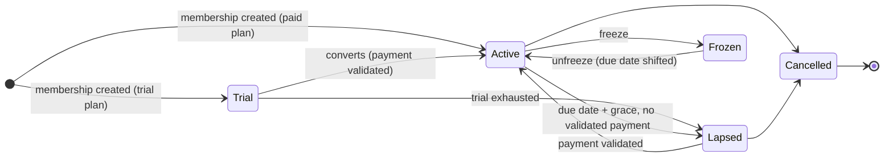
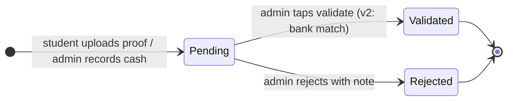
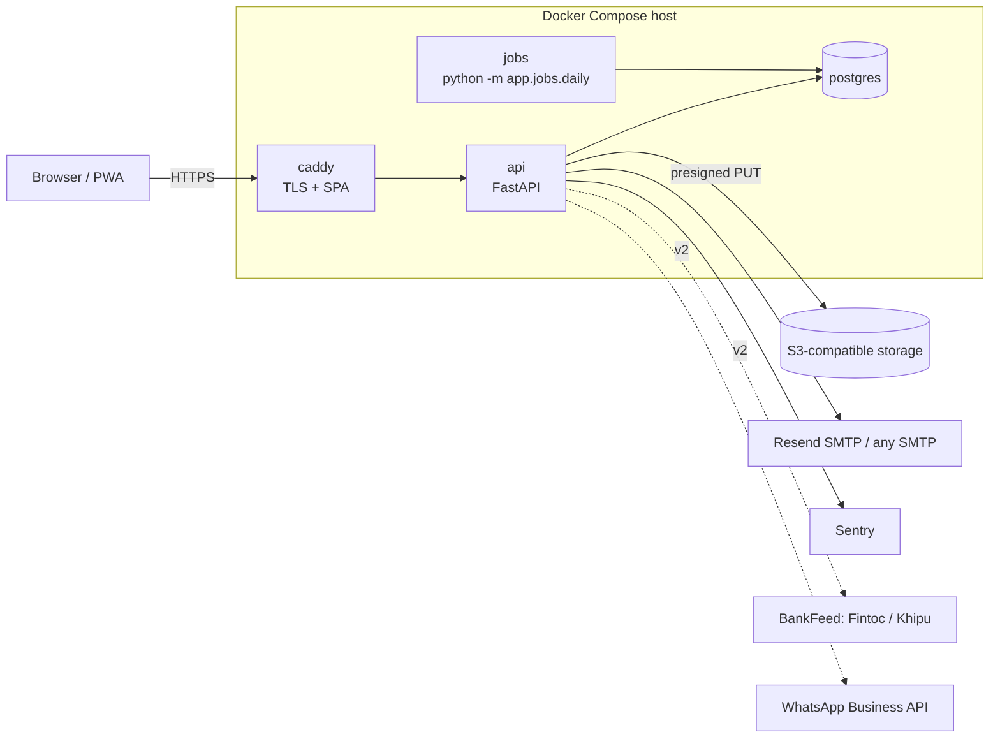

# Rakin — Technical design

> Scope and personas live in [product.md](product.md); screens in [design/ui-design.html](design/ui-design.html).

## Sport-agnostic design

Three configuration surfaces absorb all sport variance; the rest of the system is identical for BJJ, judo, Muay Thai or boxing. All three live as JSON in `gym.settings` (definitions) and as rows (values).

**Grading scheme** — an ordered list of ranks, each with optional sub-ranks, plus an optional separate kids ladder. Promotion events reference rank and sub-rank by key.

| Sport | Ranks | Sub-ranks | Kids ladder | Goal metric |
| --- | --- | --- | --- | --- |
| BJJ | white, blue, purple, brown, black | 0–4 stripes | grey, yellow, orange, green (with white/solid/black variants) | classes since last promotion |
| Judo / karate | kyu 10→1, dan 1→10 | none | same ladder, slower | time in rank |
| Muay Thai | none, or prajioud arm-band colours | none | none | none |
| Boxing / MMA | none | none | none | none |

**Plan types** — one enum, five kinds, parameters per kind.

| Kind | Parameters | Billing behaviour |
| --- | --- | --- |
| monthly | price, anchor (signup day or 1st) | charge each period; freeze shifts next due date |
| prepaid | price, period\_months | one charge, membership valid for N months |
| credits | price, credits, credit\_expiry\_days | one charge; each attendance decrements; lapsed at 0 or expiry |
| dropin | price | one charge, one attendance, no membership persistence |
| trial | free\_classes or free\_days | zero charge; converts or lapses |

**Custom fields** — per-gym definitions `{key, label, type, options?, sensitive?, visible_to}`; values stored per person per gym. Weight, competition record, insurance number, federation ID, emergency contact. `visible_to` (`owner`, `admin` or `staff`) is who among the staff sees the field, set by the owner only. Fields marked `sensitive` start as `owner`, are encrypted at rest and excluded from exports unless explicitly included (see Compliance).

Anything a gym asks for that doesn't fit these three surfaces is either a non-goal or a core feature for all sports, never a sport-specific branch.

## Domain model

One Postgres schema. `person` is the global identity, one row per phone; what a gym knows about someone lives in `gym_person`, that gym's own record of them. Everything but `person` carries `gym_id` and is isolated by row-level security, and a gym reads only its own people's `person.id` and `person.phone`. `membership` is the join between a person and a gym's plan, and the ledger, attendance and grades hang off it.

Adding someone by a phone another gym already has attaches the existing person, and the gym cannot tell: the answer is the same as for a new phone, and it holds only what this gym entered. Two gyms sharing a member each keep and edit their own name, email, RUT and date of birth for them, so a phone typed in one gym never reveals another gym's record or memberships.

| Table | Key columns | Notes |
| --- | --- | --- |
| `person` | id, phone (E.164, unique), email, name, rut, dob | global; phone is the identity because it is what WhatsApp uses; email, name, rut and dob are the person's own record, never shown to a gym |
| `gym_person` | gym\_id, person\_id, name, email, rut, dob, created\_at, updated\_at | a gym's own record of a person; one per gym and person, edited only by that gym |
| `guardian_link` | gym\_id, guardian\_person\_id, dependent\_person\_id, created\_at | one payer, N dependents, per gym; one guardian per dependent, one level deep; the guardian is in the gym through it, and gets every notice about the dependent |
| `gym` | id, name, slug, timezone, settings jsonb | settings = channels, grace days, reminder cadence, bank details, grading scheme, custom-field definitions |
| `staff` | person\_id, gym\_id, role (owner, admin, coach) | roles are per gym; coach role cannot read ledger, refused by the API and by RLS on `ledger_entry` |
| `plan` | id, gym\_id, name, kind, program\_id, price\_clp, anchor, period\_months, credits, credit\_expiry\_days, active | kind ∈ monthly, prepaid, credits, dropin, trial; each kind sets only its own parameters; a trial's free classes and free days are `credits` and `credit_expiry_days`; program\_id is the program its members are in, none for a plan open to any class; deactivated, never deleted |
| `membership` | id, person\_id, gym\_id, plan\_id, status, anchor\_day, started\_at, current\_period\_end, credits\_remaining, discount\_pct, next\_plan\_id, next\_plan\_from, cancel\_reason, cancelled\_at | status ∈ trial, active, frozen, lapsed, cancelled; a plan change waits in next\_plan\_id until next\_plan\_from, the first period not yet billed; cancelled carries its reason and is final |
| `membership_freeze` | gym\_id, membership\_id, from\_date, to\_date, reason, created\_by | a freeze from its first day until to\_date, when the membership is Active again; shifts current\_period\_end, and the billing periods not yet started, by the frozen days as it starts; `freeze` is a reserved word in Postgres; append-only |
| `billing_period` | id, membership\_id, period\_start, period\_end, amount\_due\_clp, due\_date | generated nightly; the thing reminders point at |
| `ledger_entry` | id, gym\_id, membership\_id, billing\_period\_id, amount\_clp, kind, status, method, claimed\_by, claimed\_at, validated\_by, validated\_at, proof\_object\_key, bank\_tx\_ref, note | kind ∈ charge, payment, adjustment, refund; status ∈ pending, validated, rejected; method ∈ cash, transfer, other, or none; append-only |
| `program` | id, gym\_id, name, active | the gym's own groups: adults, kids, competition, …; name unique in the gym; deactivated, never deleted |
| `class_type` | id, gym\_id, name, program\_id, credit\_cost, active | one program each; credit\_cost is what an attendance takes from a credits membership, 0 for a free class; name unique within its program; deactivated, never deleted |
| `session` | id, gym\_id, class\_type\_id, starts\_at, coach\_id, topic, notes | one row per class actually held, started by the coach when it begins (no timetable); the day's sessions are those starting that day in the gym's timezone; coach\_id is the gym's record of a person, staff when the session was started; never deleted |
| `attendance` | gym\_id, session\_id, membership\_id, marked\_by, marked\_at, credits\_consumed | unique (session, membership); credits\_consumed is what it took from a credits pack (the class type's credit\_cost) or a trial (one free class), given back when it is unmarked; never refused, so a spent pack or a lapsed member attends for nothing; added and deleted, never changed |
| `grade_event` | gym\_id, membership\_id, rank\_key, sub\_rank, awarded\_on, awarded\_by, note, created\_at | promotion log; keys of the gym's grading scheme; current rank is the latest by awarded\_on over the person's memberships; append-only; one that becomes current writes a `promoted` plan\_event |
| `person_field_value` | person\_id, gym\_id, field\_key, value jsonb | custom fields; sensitive keys encrypted |
| `message_log` | gym\_id, person\_id, channel, template, to\_address, status, error, sent\_at, payload jsonb | audit of every email sent: one row per attempt, status ∈ sent, failed, suppressed; payload is what the template was rendered from, never a magic link's URL; sign-in links belong to no gym and have no gym\_id; append-only |
| `mail_unsubscribe` | gym\_id, person\_id, created\_at | one-click unsubscribe from that gym's non-essential notices |
| `badge_token` | membership\_id, token, issued\_at, expires\_at | signed QR for cross-gym verification |
| `agreement` | gym\_a\_id, gym\_b\_id, rule jsonb, active | v2: reciprocal terms |
| `visit` | person\_id, host\_gym\_id, home\_membership\_id, agreement\_id, at | v2: cross-gym visit log |
| `plan_event` | gym\_id, membership\_id, kind, occurred\_on | outbox for plan-event emails; kind ∈ frozen, unfrozen, lapsed, promoted; written with the state change it reports |
| `job_run` | job\_name, run\_date, status, started\_at, finished\_at | idempotency for nightly jobs |

Derived views, not tables: `v_overdue` (billing periods past due with no validated payment), `v_balance` (per membership, sum of ledger), `v_inactive` (last attendance > N days), `v_monthly_income` (validated payments by month).

## Core state machines

Membership moves right as time passes and only moves back to Active when a payment is validated; a freeze is a side trip that shifts the due date by the frozen days. A payment entry is created pending by a student's proof upload, and becomes validated by an admin tap or, in v2, a bank match. A payment an admin records (cash, a transfer they saw arrive, or other) has no proof to check, so it is created validated by that admin.

Rules the diagram does not show:

- Grace period is per gym (default 5 days). Overdue and lapsed students can still be marked present; the roster shows an orange dot on anyone with a period overdue, so the coach can nudge, and never the amount.
- A `credits` membership also lapses when `credits_remaining` reaches 0 or the pack expires.
- Validating a payment against a billing period closes that period; an overpayment creates a credit adjustment against the next one.
- Rejecting a proof notifies the student with the admin's note and keeps the period open.
- Nothing is ever deleted: cancellation and rejection are terminal states, corrections are new entries.
- The nightly job ends the freezes due (Frozen → Active on to\_date), generates billing periods 7 days ahead, flips Active → Lapsed after grace, and expires credits. It is idempotent per date via `job_run`.
- A freeze starts the day it is recorded and moves the due date past the frozen days at once, so a frozen member always reads the day they next pay. What was owed before the freeze is still owed.
- A period due on day D is in grace through D + grace days and lapses the membership on the day after, if validated payments still leave it short. Each lapse writes a `lapsed` plan event.

## Communications

Email is the system of record; WhatsApp is where the reminder gets read. Neither requires an app install, and the channel mix is configurable per gym.

| Message | Channel (v1) | Trigger | Notes |
| --- | --- | --- | --- |
| Welcome + first magic link | email | membership created | sets expectations: how to pay, how to upload proof |
| Upcoming charge (statement) | email | 7 days before due (nightly `statements` job) | amount, due date, bank details, magic link to upload |
| Reminder | WhatsApp via `wa.me` deep link from admin's overdue list | due date, then every 3 days while overdue (admin taps) | prefilled Spanish template; API automation is v2 |
| Proof received | email to student, in-app badge to admin | upload | admin sees pending count on dashboard |
| Payment validated (receipt) | email | validation | includes period covered and running balance |
| Proof rejected | email + wa.me suggestion | rejection | carries admin's note |
| Plan events (frozen, unfrozen, lapsed, promoted) | email | state change | optional per gym |
| Announcements | email + copy-to-WhatsApp text | admin sends | one message to a program or everyone |
| Inactive nudge | wa.me from retention list | 14 / 30 days without attendance | automation is v2 |

**Email:** hosted Rakin sends from `@rakin.app` through [Resend](https://resend.com)'s SMTP relay (`smtp.resend.com`, user `resend`, the API key as password), with the same `SmtpMailer` self-hosters point at any SMTP server; no provider SDK. Resend rather than Amazon SES because it needs no AWS account just for mail and no sandbox approval before the first real send. Verified domain, DKIM, SPF, DMARC `p=quarantine` from day one; transactional only, no marketing content. Expected cost: cents per gym per month.

Every email is a template in `backend/app/notices/templates`, Spanish text and HTML from the same values, and every attempt is a `message_log` row with its outcome. Notices are essential (sign-in links, statements, proofs, receipts) or not (plan events, announcements). A non-essential one carries a one-click unsubscribe link in its footer and as `List-Unsubscribe` with `List-Unsubscribe-Post: List-Unsubscribe=One-Click` (RFC 8058); the link is a signed token for the gym and the person, opening it shows a button, and a `POST` (the button, or the mail client's one click) records a `mail_unsubscribe` row. From then on that gym's non-essential notices to them are recorded as `suppressed` instead of sent. Essential notices always go.

**WhatsApp:** v1 uses `https://wa.me/<phone>?text=<template>` links so the admin sends from their own phone with zero Meta involvement. v2 adds the WhatsApp Business API as an opt-in plugin: requires Meta business verification and template approval; budget ≈ USD 0.05 per template message, so ≈ USD 7/month for a 70-student gym at 2 reminders each.

**PWA:** manifest + service worker via `vite-plugin-pwa`. Push notifications are a v2 nicety, not a dependency; every link in every message must work in a plain browser tab. The student page detects iOS Safari outside standalone mode and shows a one-time Add-to-Home-Screen hint.

**Magic links:** signed token, single use, exchanged for a 30-day session cookie. One a person asks for expires in 15 minutes; the one every notice carries to the student page is issued as the notice is sent and expires in 7 days, since a statement is read days before it is due. Students never set a password. Staff get optional passwords plus TOTP in v2.

## Architecture

Caddy terminates TLS and serves the built SPA; FastAPI is the only thing that talks to Postgres; the nightly job is a second process on the same image. Dashed boxes are v2 plugins behind an interface with a no-op or local default, so a self-hosted instance works with none of them.

| Concern | Decision | Why |
| --- | --- | --- |
| Tenancy | shared schema, `gym_id` on every tenant table, Postgres RLS with `SET LOCAL app.gym_id` per request | a missed `WHERE` returns nothing instead of another gym's ledger; schema-per-tenant breaks global identity |
| API | FastAPI, SQLAlchemy 2, Alembic, Pydantic v2 schemas separate from ORM models | boring and known; async where I/O-bound |
| Auth | magic links to a session cookie (`HttpOnly`, `Secure`, `SameSite=Lax`); API and SPA on one origin | no passwords for students, no CORS |
| Frontend | one Vite SPA, `/admin` and `/me` route trees, TanStack Query, `vite-plugin-pwa`, Spanish strings in one i18n file | one build, PWA for free, English later |
| Jobs | APScheduler or system cron running `python -m app.jobs.daily`; `job_run` table for idempotency | three jobs do not justify Celery or Redis |
| Files | presigned PUT to S3-compatible storage; key stored on `ledger_entry` | proofs never pass through the API process |
| Email | SMTP behind the `Mailer` interface: Resend's relay hosted, any SMTP server self-hosted | one implementation for both; no AWS account or sandbox approval just for mail |
| Time | UTC in the database, `gym.timezone` for all due-date math | Chile shifts DST; naive local arithmetic will drift |
| Money | integer CLP, no decimals | CLP has no cents; avoids float bugs |
| Reporting | SQL views (`v_overdue`, `v_balance`, `v_inactive`, `v_monthly_income`) | no warehouse, no dbt, no DuckDB in year one |
| Integrations | `PaymentRail`, `BankFeed`, `Messenger`, `Mailer`, `BlobStore` interfaces with local defaults | plugins stay optional; OSS self-host works offline |

## Infrastructure and operations

One VPS running Docker Compose carries the first 20 gyms; the only non-negotiable spend is tested backups, because losing a gym's ledger is the one unrecoverable failure.

| Option | USD / month | Pros | Cons |
| --- | --- | --- | --- |
| Hetzner or DigitalOcean VPS, 2 vCPU / 4 GB, Compose, Postgres in a container | 8–15 | cheapest; identical to the self-host story | you own Postgres upgrades and backups |
| EC2 t4g.small + RDS db.t4g.micro | 30–40 | familiar; RDS does PITR | \~3× the cost for nothing a gym notices |
| Fly.io or Railway + managed Postgres | 15–30 | deploy from git, São Paulo region | less control, pricing creep |

**Chosen:** VPS + Compose. Region: São Paulo if the provider has it (≈40 ms from Chile), otherwise US East (≈130 ms); avoid Europe (≈250 ms) for a mobile-first CRUD app.

**Compose services:** `caddy`, `api`, `jobs`, `postgres`, plus [Garage](https://garagehq.deuxfleurs.fr/) only in the self-host profile (hosted uses real S3-compatible storage). Garage rather than MinIO because MinIO stopped publishing public container images.

**Backups:** nightly `pg_dump` to object storage with 30-day retention, plus continuous WAL archiving with `pgbackrest` or `wal-g` for point-in-time recovery. A restore is rehearsed before the second gym onboards and quarterly after. Proof images are already in object storage with versioning on.

**Deploy:** GitHub Actions builds one image per commit on `main`; a tagged release triggers `docker compose pull && up -d` over SSH, migrations run as a one-shot container before `api` restarts. Rollback is `compose up` on the previous tag; migrations are always additive within a release so the previous image keeps working. The runbook is [deploy.md](deploy.md).

**Observability:** structured JSON logs to stdout, Sentry free tier for API and SPA, an external uptime ping every 5 minutes on `/healthz`, a weekly email with `v_monthly_income` deltas per gym so silent breakage in the nightly job is noticed.

**Domain and DNS:** `rakin.app` on Cloudflare Registrar (at-cost renewal, `.app` enforces HTTPS). Cloudflare DNS with the app records DNS-only (grey cloud) so Caddy keeps doing TLS via Let's Encrypt; the proxy stays off unless a marketing page needs it. Email Routing forwards `hola@` and `soporte@` for free; SPF, DKIM and DMARC (`p=none` for two weeks, then `quarantine`) are set the day the domain is registered so the records age before the first reminder goes out.

**Secrets:** `.env` on the host, never in the image; the self-host `.env.example` lists every variable with a working local default.

## Open source strategy

AGPL-3.0 on the whole product, a trademark on the name,. Nothing is gated: single- and multi-tenant modes are both in this repo.

| Decision | Choice | Rationale |
| --- | --- | --- |
| License | AGPL-3.0 | a hosted fork must publish its changes; gyms don't care, developers accept it |
| Trademark | the name Rakin and rakin.app are reserved; see TRADEMARK.md | forks can't ship under the same name |
| Contributions | DCO sign-off, not a CLA | lighter, sufficient for AGPL |
| Self-host contract | `docker compose up` with `.env.example` works in under 10 minutes with seed data; every integration has a local or no-op default; versioned releases with forward-only migrations; one-command export/import | if this isn't true the OSS story is marketing |

**Repo hygiene:** README in Spanish (for owners) and English (for developers), `CONTRIBUTING.md`, issue templates, public roadmap as GitHub issues, CI running migrations and tests against real Postgres, signed release tags.

**Pieces to extract as standalone packages when they stabilise:** Fintoc/Khipu reconciliation matcher, Chilean RUT validation and formatting, magic-link auth module for FastAPI. These are what other developers would actually reuse.

## Compliance and privacy

Chile's Ley 21.719 (personal data protection) enters into force on 1 December 2026; the product stores minors' data and optionally health-adjacent fields, so the minimum posture below is in v1, not deferred.

| Topic | Obligation | Product response |
| --- | --- | --- |
| Data controller | whoever runs the instance is responsible: the company for hosted gyms, each self-hoster for theirs | stated in README and hosted terms; a DPA template for hosted gyms |
| Consent | explicit, informed, revocable | consent captured at membership creation (adult) or by guardian (minor), stored with timestamp and text version |
| Minors | guardian consent; no direct marketing | kids never receive messages; all comms go to the guardian |
| Sensitive data | health data (weight, injuries, conditions) is sensitive and needs explicit consent | custom fields flagged `sensitive` are encrypted at rest (app-level, AES-GCM), excluded from default exports, and visible to the roles the owner chooses per field (`visible_to`: owner only, owner and admins, or all staff), owner only by default; the API never answers a field's definition or value to a role it is not visible to, with a per-gym toggle to disable entirely |
| Access and deletion | right to access, rectify, delete | student page shows all stored data; one-click JSON export; deletion anonymises the person row and keeps ledger amounts (legitimate interest: accounting) |
| Retention | no longer than necessary | lapsed memberships anonymised after 24 months unless the gym opts out; proof images deleted 12 months after validation |
| Waivers | climbing requires signed liability waivers; BJJ academies use them for minors | v2: on-phone signature, PDF stored per person with version of the text signed |
| Security | reasonable measures | TLS only, RLS, magic links expire, audit via `message_log` and ledger `validated_by`, backups encrypted |

**Open question:** whether a 4-year-old's belt and attendance history counts as profiling under the new law. Conservative reading: it does not, but kids' records carry no custom fields by default.
