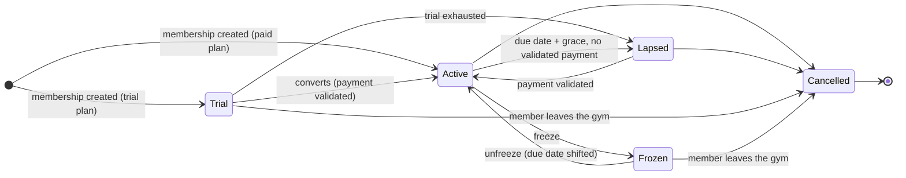
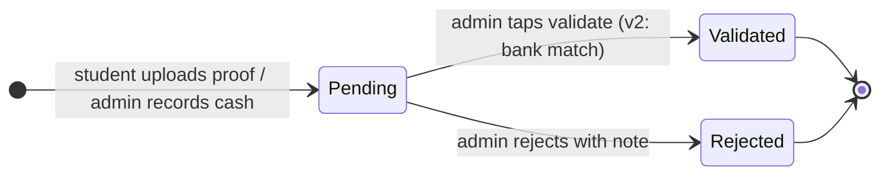
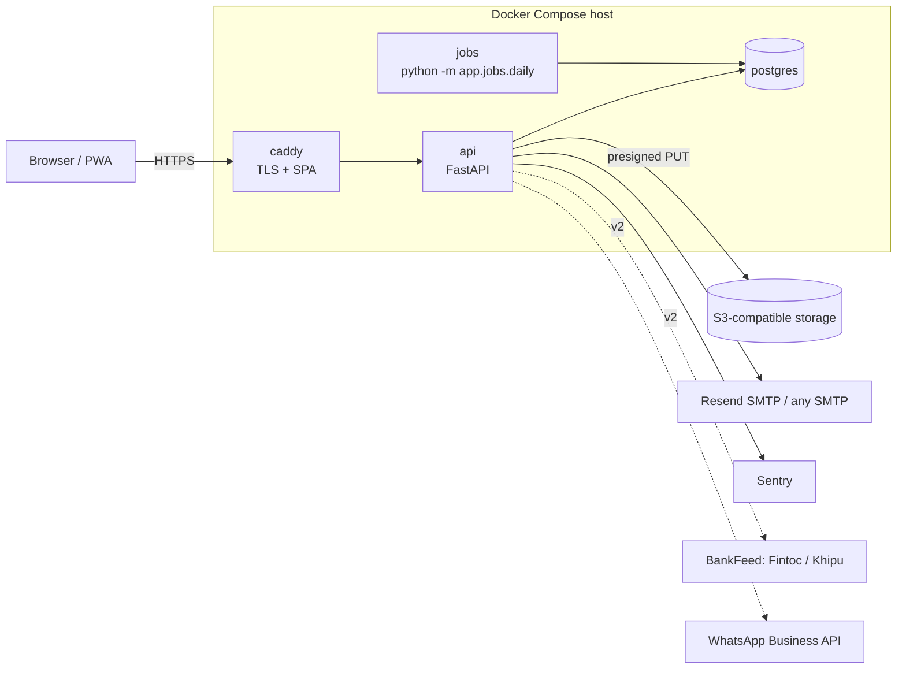

# Rakin — Technical design

> Scope and personas live in [product.md](product.md); screens in [design/ui-design.html](design/ui-design.html).

## Sport-agnostic design

Three configuration surfaces absorb all sport variance; the rest of the system is identical for a BJJ academy, a football school, a swimming club or a chess club. All three live as JSON in `gym.settings` (definitions) and as rows (values).

**Activities** — what a gym teaches (#245): one or more `gym_activity` rows, from the presets Ajustes › Gimnasio offers (BJJ, Judo, Ballet, Piano, Escalada, …) or named by the gym, each with `uses_grades`. Belts and ranks show only while one of the gym's activities uses grades (`uses_grades` on `/api/me/role`): with none, Ajustes › Graduación, the belt filters in Alumnos and the group builder, the rank on the ficha, the class roster and `/me`, and promotions are all hidden, though the API still serves them. A class type may belong to an activity. A new gym's Hoy checklist asks for its activities first.

**Grading scheme** — optional, and one per gym, shared by every activity that uses grades (Graduación says so when there are two or more): a gym with no ranks (the `none` preset, and what `app.gyms create` gives a new gym unless `--grading` names a preset, which also gives it one graded activity) shows no belt, rank or "Registrar graduación" anywhere, the ficha, the class roster, `/me`, Hoy and the setup checklist alike. An ordered list of ranks, each with optional sub-ranks, plus an optional separate kids ladder. Promotion events reference rank and sub-rank by key. A rank may carry its belt's colours (one, or two for a two-tone belt); such a rank is drawn as a belt, its stripes counted by the sub-rank's place after the first, and one without colours shows as its label.

| Sport | Ranks | Sub-ranks | Kids ladder | Goal metric |
| --- | --- | --- | --- | --- |
| BJJ | white, blue, purple, brown, black | 0–4 stripes | grey, yellow, orange, green (with white/solid/black variants) | classes since last promotion |
| Judo / karate | kyu 10→1, dan 1→10 | none | same ladder, slower | time in rank |
| Muay Thai | none, or prajioud arm-band colours | none | none | none |
| Boxing / MMA | none | none | none | none |

**Plan types** — one enum, five kinds, parameters per kind.

| Kind | Parameters | Billing behaviour |
| --- | --- | --- |
| monthly | price, anchor (signup day or 1st) | charge each period; freeze shifts next due date |
| prepaid | price, period\_months | one charge, membership valid for N months |
| credits | price, credits, credit\_expiry\_days | one charge; each attendance decrements; lapsed at 0 or expiry |
| dropin | price | one charge, one attendance, no membership persistence |
| trial | free\_classes or free\_days | zero charge; converts or lapses |

**Custom fields** — per-gym definitions `{key, label, type, options?, sensitive?, visible_to}`; values stored per person per gym. Weight, competition record, insurance number, federation ID, emergency contact. `visible_to` (`owner`, `admin` or `staff`) is who among the staff sees the field, set by the owner only. Fields marked `sensitive` start as `owner`, are encrypted at rest and excluded from exports unless explicitly included (see Compliance).

The class vocabulary is defaults a gym edits, not assumptions: block kinds (Calentamiento, Técnica, Drilling, Juegos, Sparring, Otro) are renamed, archived or added in Ajustes › Bloques, and "open mat" is a class-type kind a gym need not use. Sparring blocks, run in rounds by the coach's timer, are only there for a gym that marks a kind as sparring.

Anything a gym asks for that doesn't fit these three surfaces is either a non-goal or a core feature for all sports, never a sport-specific branch.

## Domain model

One Postgres schema. `person` is the global identity, keyed by RUT when there is one; what a gym knows about someone lives in `gym_person`, that gym's own record of them. Everything but `person` carries `gym_id` and is isolated by row-level security, and a gym reads only its own people's `person.id`. `membership` is the join between a person and a gym's plan, and the ledger, attendance and grades hang off it.

Someone is their RUT, or, with none (a foreigner, a coach who won't give one), an email in the gym that adds them (migration 0036). Adding someone by a RUT another gym already has attaches the existing person, and the gym cannot tell: the answer is the same as for a new RUT, and it holds only what this gym entered. An email never links two gyms' people: a second gym that adds the same address with no RUT gets a person of its own. A child with neither is a person of their own under their guardian. An old sheet's adult with neither imports too, as "Falta RUT", found again only by name inside the gym (the birth date, then the phone, telling two of one name apart); a RUT given later becomes who they are when nobody has it (`claim_rut`). One someone in another gym already has is kept on the gym's record and links nobody: that would be a merge, not yet built. Two gyms sharing a member each keep and edit their own name, email, RUT, phone and date of birth for them, so a RUT typed in one gym never reveals another gym's record or memberships. Only `join_gym` adds a person; the API cannot insert into `person` itself, so no unique violation tells it a RUT is taken.

The phone is a contact, never an identity: phones change, are shared within a family and are recycled. It lives on `gym_person`, where the WhatsApp links go. A member needs one, since the gym reaches them on WhatsApp, unless the gym ticks "No tiene WhatsApp" (`no_whatsapp`), which also hides every WhatsApp action for them; a minor's guardian's is the one required; staff need none. A member left with neither, as an import row with a blank cell or a record the migration found with no phone, shows "Falta teléfono" and is on the Alumnos filter of that name until one is filled in.

| Table | Key columns | Notes |
| --- | --- | --- |
| `person` | id, rut (normalised, unique when present), email, name, dob | global; the RUT is the identity, and someone with none is keyed by an email in one gym; email, name, rut and dob are what the first gym entered, never shown to a gym |
| `gym_person` | gym\_id, person\_id, name, email, rut, phone, no\_whatsapp, dob, left\_on, created\_at, updated\_at | a gym's own record of a person; one per gym and person, edited only by that gym; the API refuses a RUT someone else in the gym has, or the email of someone here with no RUT; phone (E.164) is the WhatsApp contact, not unique; no\_whatsapp is "No tiene WhatsApp"; left\_on is the day they left (dado de baja), off the member list until reactivated |
| `guardian_link` | gym\_id, guardian\_person\_id, dependent\_person\_id, created\_at | one payer, N dependents, per gym; one guardian per dependent, one level deep; the guardian is in the gym through it, and gets every notice about the dependent |
| `gym` | id, name, slug, timezone, settings jsonb | settings = channels, grace days, reminder cadence, bank details, grading scheme, custom-field definitions |
| `staff` | person\_id, gym\_id, role (owner, admin, coach) | roles are per gym; coach role cannot read ledger, refused by the API and by RLS on `ledger_entry` |
| `plan` | id, gym\_id, name, kind, program\_id, price\_clp, anchor, period\_months, credits, credit\_expiry\_days, active | kind ∈ monthly, prepaid, credits, dropin, trial; each kind sets only its own parameters; a trial's free classes and free days are `credits` and `credit_expiry_days`; program\_id is the program its members are in, none for a plan open to any class; deactivated, never deleted |
| `membership` | id, person\_id, gym\_id, plan\_id, status, anchor\_day, started\_at, current\_period\_end, credits\_remaining, discount\_pct, next\_plan\_id, next\_plan\_from, cancel\_reason, cancelled\_at | status ∈ trial, active, frozen, lapsed, cancelled; a plan change waits in next\_plan\_id until next\_plan\_from, the first period not yet billed; cancelled carries its reason and is final |
| `membership_freeze` | gym\_id, membership\_id, from\_date, to\_date, reason, created\_by | a freeze from its first day until to\_date, when the membership is Active again; shifts current\_period\_end, and the billing periods not yet started, by the frozen days as it starts; `started` is false on one booked ahead until the job starts it; ended early or given a new end, to\_date moves and the dates move again by the difference; `freeze` is a reserved word in Postgres |
| `billing_period` | id, membership\_id, period\_start, period\_end, amount\_due\_clp, due\_date | generated nightly; the thing reminders point at |
| `ledger_entry` | id, gym\_id, membership\_id, billing\_period\_id, extra\_line\_id, amount\_clp, kind, status, method, claimed\_by, claimed\_at, validated\_by, validated\_at, proof\_object\_key, bank\_tx\_ref, note, refund\_of | kind ∈ charge, payment, adjustment, refund; status ∈ pending, validated, rejected; method ∈ cash, transfer, other, or none; amounts positive but an adjustment's, signed; a refund references its payment; on a membership (and its period) or a cobro extra line, never both; append-only |
| `extra_charge` | id, gym\_id, title, description, message, category, due\_date, amount\_mode, amount\_clp, target\_kind, target\_label, created\_by | a cobro extra (#195): category ∈ rifa, seminario, equipamiento, gasto\_compartido, otro; amount\_mode ∈ fixed (amount\_clp each), split (amount\_clp divided, the remainder a peso more for the first alphabetically); target\_kind ∈ active, program, group, people; owner and admin only, plus a person's own |
| `extra_line` | id, gym\_id, extra\_charge\_id, person\_id, amount\_due\_clp, overridden, cancelled\_at, cancelled\_by | one per person a cobro charges, settled by ledger entries as a billing period is; amount changes by an override or a re-split, cancelled (anulado) only with no money on it; never touches a membership |
| `charge_group` | id, gym\_id, name | a named, reusable list of people (`charge_group_member`) a cobro can target; a snapshot, not a live filter; name unique in the gym, ignoring case |
| `program` | id, gym\_id, name, active | the gym's own groups: adults, kids, competition, …; name unique in the gym; deactivated, never deleted |
| `gym_activity` | id, gym\_id, name, uses\_grades | what the gym teaches; name unique in the gym case ignored; kept by an owner or admin, read by any staff; deleted outright, which leaves its class types with none; while any has uses\_grades the gym's belts and ranks show. Migration 0043 gave a gym with a scheme of ranks or a recorded rank one, "BJJ", with grades on, and every other gym none |
| `class_type` | id, gym\_id, name, program\_id, credit\_cost, kind, counts\_as\_class, active, activity\_id | one program each, and optionally one activity; credit\_cost is what an attendance takes from a credits membership, 0 for a free class; kind ∈ class, open\_mat; counts\_as\_class says whether attending counts towards a student's classes, by default true for a class and false for an open mat; name unique within its program; deactivated, never deleted |
| `schedule_slot` | id, gym\_id, class\_type\_id, weekdays, start\_time, duration\_minutes, coach\_id, topic, valid\_from, valid\_to, generated\_until | one class of the weekly timetable; makes one session per date it runs on, 14 days ahead (nightly, and when saved); changed from a date on by ending it and starting another, never rewriting a class held, started or with attendance |
| `closed_day` | gym\_id, day, label | a date in the gym's timezone with no classes; the schedule makes none on it |
| `class_tag` | id, gym\_id, name, archived | one of the gym's recurring focuses ("Pasaje de guardia", "Fuerza"), name unique in the gym case ignored; kept by an owner or admin; archived, never deleted: it stays on the classes that have it and still counts, and goes on no new one |
| `session_tag`, `schedule_slot_tag` | gym\_id, session\_id or slot\_id, tag\_id | a class's tags, set by its coach, an admin or the owner, and a slot's default tags, which each class it makes starts with (archived ones left off); a slot change gives its new tags to the classes it may still change that carry its old ones. Hours per tag are each class's duration added to every tag it carries: a person's attended classes (student page, ficha) or the gym's held ones, begun and not cancelled (Clases) |
| `session` | id, gym\_id, class\_type\_id, starts\_at, duration\_minutes, coach\_id, topic, notes, cancelled\_at, slot\_id, slot\_date | one row per class, made ahead by the weekly schedule (slot\_id and slot\_date, the date it was made for, unique together) or started by the coach when it begins; the day's sessions are those starting that day in the gym's timezone; coach\_id is the gym's record of a person, staff when the session was started; an owner or admin moves it or changes its type or coach, its coach writes its topic and notes and sets its tags; the notes are staff's alone, never in a student's or guardian's response; cancelled\_at set for a class that won't happen, which takes no attendance and counts for nothing, refused once attendance was taken; deleted only by an owner or admin (RLS too), with its attendance, credits given back, and its blocks |
| `attendance` | gym\_id, session\_id, membership\_id, marked\_by, marked\_at, credits\_consumed | unique (session, membership); credits\_consumed is what it took from a credits pack (the class type's credit\_cost) or a trial (one free class), given back when it is unmarked; never refused, so a spent pack or a lapsed member attends for nothing; added and deleted, never changed |
| `block_kind` | id, gym\_id, name, is\_sparring, position, archived | the parts a class is run in (Calentamiento, Técnica, Drilling, Juegos, Sparring, Otro by default, given to every gym as it is created); is\_sparring drives a student's sparring total; name unique in the gym; one in use is archived, not deleted, and its is\_sparring is fixed |
| `session_block` | id, gym\_id, session\_id, position, block\_kind\_id, planned\_seconds, actual\_seconds, rounds\_planned, rounds\_completed, round\_seconds, rest\_seconds | a session's plan in order and what each block ran (actual\_seconds null until then, less when stopped early); a sparring kind's block is rounds, and its seconds are the rounds' alone, rest not included; an open mat's plan is one sparring block; a student's time is the blocks of every session they attended, late or not |
| `grade_event` | gym\_id, membership\_id, rank\_key, sub\_rank, awarded\_on, awarded\_by, note, created\_at | promotion log; keys of the gym's grading scheme; current rank is the latest by awarded\_on over the person's memberships; append-only; one that becomes current writes a `promoted` plan\_event |
| `person_field_value` | person\_id, gym\_id, field\_key, value jsonb | custom fields; sensitive keys encrypted |
| `message_log` | gym\_id, person\_id, channel, template, to\_address, status, error, sent\_at, payload jsonb | audit of every message sent: one row per attempt, channel ∈ email, whatsapp, status ∈ sent, failed, suppressed; a WhatsApp row is written when the admin opens its `wa.me` link, which is all `sent` can mean there; payload is what the template was rendered from, never a magic link's URL; sign-in links belong to no gym and have no gym\_id; append-only |
| `mail_unsubscribe` | gym\_id, person\_id, created\_at | one-click unsubscribe from that gym's non-essential notices |
| `join_link` | gym\_id, token, program\_id, expires\_on, created\_at | the gym's one join link, `/unirse/<token>`; regenerating replaces the token, revoking deletes the row; program\_id pre-selects a program, expires\_on is its last day in the gym's timezone |
| `join_request` | id, gym\_id, first\_name, last\_name, rut, phone, email, dob, guardian\_name, guardian\_phone, guardian\_email, no\_whatsapp, program\_id, consented\_at, created\_at | what someone sent through the join link, waiting for staff; not a person: approving adds them through the import's path and deletes it, rejecting deletes it, and the nightly job deletes any left 30 days |
| `badge_token` | membership\_id, token, issued\_at, expires\_at | signed QR for cross-gym verification |
| `agreement` | gym\_a\_id, gym\_b\_id, rule jsonb, active | v2: reciprocal terms |
| `visit` | person\_id, host\_gym\_id, home\_membership\_id, agreement\_id, at | v2: cross-gym visit log |
| `plan_event` | gym\_id, membership\_id, kind, occurred\_on | outbox for plan-event emails; kind ∈ frozen, unfrozen, lapsed, promoted; written with the state change it reports; one per membership, kind and day, so a second change of a kind that day (a freeze ended twice) writes no second event, and created\_by names the first |
| `job_run` | job\_name, run\_date, status, started\_at, finished\_at | idempotency for nightly jobs |

Derived views, not tables: `v_overdue` (billing periods past due with no validated payment), `v_balance` (per membership, sum of ledger; a cobro line's entries are not a membership's), `v_inactive` (last attendance > N days), `v_monthly_income` (validated payments less refunds, by month).

## Core state machines

Membership moves right as time passes and only moves back to Active when a payment is validated; a freeze is a side trip that shifts the due date by the frozen days. A payment entry is created pending by a student's proof upload, and becomes validated by an admin tap or, in v2, a bank match. A payment an admin records (cash, a transfer they saw arrive, or other) has no proof to check, so it is created validated by that admin.

Rules the diagram does not show:

- Grace period is per gym (default 5 days). Overdue and lapsed students can still be marked present; the roster shows an orange dot on anyone with a period overdue, so the coach can nudge, and never the amount.
- A `credits` membership also lapses when `credits_remaining` reaches 0 or the pack expires.
- Validating a payment against a billing period closes that period; an overpayment creates a credit adjustment against the next one.
- An adjustment on a period is positive in the member's favour, counting towards it, or negative, owed on top; a note says why. A refund gives back part or all of a validated payment and no longer counts towards its period.
- Rejecting a proof notifies the student with the admin's note and keeps the period open.
- Nothing is ever deleted: cancellation and rejection are terminal states, corrections are new entries. Two exceptions: a join request, someone's details before the gym has agreed to keep them, which is deleted once approved or rejected, or after 30 days; and a person added by mistake or asking to be erased, with no ledger entries in the gym, whose records the owner can delete (#157).
- A member who leaves (dado de baja) has every membership cancelled with the reason `dado de baja`, a trial or a frozen one too; what they owe stays owed, nothing starts them on a plan again until they are reactivated, and reactivating them starts a new membership if they need one.
- The nightly job starts the freezes booked for the day and ends the freezes due (Frozen → Active on to\_date), generates billing periods 7 days ahead (a membership starting, or a member paying months ahead, is billed by the request instead, and the job bills on after it), flips Active → Lapsed after grace, and expires credits. It is idempotent per date via `job_run`.
- A freeze starts the day it is recorded, or is booked for a later day and starts then, and moves the due date past the frozen days as it starts, so a frozen member always reads the day they next pay. Ended early or given a new end, the due date moves again by the days it no longer lasts or gains. What was owed before the freeze is still owed.
- A period due on day D is in grace through D + grace days and lapses the membership on the day after, if validated payments still leave it short. Each lapse writes a `lapsed` plan event.

## Communications

Email is the system of record; WhatsApp is where the reminder gets read. Neither requires an app install, and the channel mix is configurable per gym.

| Message | Channel (v1) | Trigger | Notes |
| --- | --- | --- | --- |
| Welcome + first magic link | email | membership created | sets expectations: how to pay, how to upload proof |
| Upcoming charge (statement) | email | 7 days before due (nightly `statements` job) | amount, due date, bank details, magic link to upload |
| Overdue payment | email (nightly `overdue` job), and "Enviar recordatorio" on the ficha's money card, Hoy's overdue rows and Pagos' overdue list (owner and admin) | due date, the day after, then every 3 days while the grace lasts (days 0, 1, 4, 7, 10, 13 with a grace of 15), while the period is unpaid and the membership Active; never twice a day for one period | `payment_overdue`: amount still owed, period, days late, bank details, magic link to upload; to the guardian for a dependent; essential, so an unsubscribe does not stop it; none while a proof for the period waits for review; the button says when the last one went out and is not offered once one did today |
| Reminder | WhatsApp via `wa.me` deep link beside "Pagó" on Hoy's overdue rows, in Hoy's "Por avisar" (due today) and in the member's ficha header | due date, then every `reminder_every_days` (3 by default) while overdue (admin taps) | prefilled Spanish template (`payment_due_today`, `payment_overdue`), to the guardian for a dependent; every WhatsApp message ends, after a blank line, with `Recordatorio automático · <gym>` so it reads as the academy's and not a staff member's own, and the overdue email carries the same line in its footer; each says which one it is ("2.º aviso") and is logged in `message_log` as opened, its period in `payload`; none while a proof for the period waits for review; API automation is v2 |
| Proof received | email to student, in-app badge to admin | upload | admin sees pending count on dashboard |
| Payment validated (receipt) | email | validation | includes period covered and running balance |
| Proof rejected | email + wa.me suggestion | rejection | carries admin's note; the `proof_rejected_followup` wa.me link is offered on "Validar comprobante" as it is rejected, and is the period's next reminder until one is sent |
| Plan events (frozen, unfrozen, lapsed, promoted) | email | state change | optional per gym |
| Announcements | email + copy-to-WhatsApp text | admin sends | one message to a program or everyone |
| Staff invite + first magic link | email | owner or admin invites an admin or coach | the role, and a 7-day link to the admin screens |
| Join request approved | email | staff approve a join link request | with a plan, the welcome above; without one, `join_approved`: they are in, with their sign-in link |
| Inactive nudge | wa.me from "A quién llamar" on Hoy | 14 / 30 days without attendance (or since joining, for someone who never came, counted from no earlier than the day Rakin had them, so an import does not list everyone) | to the guardian for a dependent; logged in `message_log` as opened; automation is v2 |

**Email:** hosted Rakin sends from `@rakin.app` through [Resend](https://resend.com)'s SMTP relay (`smtp.resend.com`, user `resend`, the API key as password), with the same `SmtpMailer` self-hosters point at any SMTP server; no provider SDK. Resend rather than Amazon SES because it needs no AWS account just for mail and no sandbox approval before the first real send. Verified domain, DKIM, SPF, DMARC `p=quarantine` from day one; transactional only, no marketing content. Expected cost: cents per gym per month.

Every email is a template in `backend/app/notices/templates`, Spanish text and HTML from the same values, and every attempt is a `message_log` row with its outcome. Notices are essential (sign-in links, statements, overdue payments, proofs, receipts) or not (plan events, announcements). A non-essential one carries a one-click unsubscribe link in its footer and as `List-Unsubscribe` with `List-Unsubscribe-Post: List-Unsubscribe=One-Click` (RFC 8058); the link is a signed token for the gym and the person, opening it shows a button, and a `POST` (the button, or the mail client's one click) records a `mail_unsubscribe` row. From then on that gym's non-essential notices to them are recorded as `suppressed` instead of sent. Essential notices always go.

**WhatsApp:** v1 uses `https://wa.me/<phone>?text=<template>` links so the admin sends from their own phone with zero Meta involvement. v2 adds the WhatsApp Business API as an opt-in plugin: requires Meta business verification and template approval; budget ≈ USD 0.05 per template message, so ≈ USD 7/month for a 70-student gym at 2 reminders each.

**PWA:** manifest + service worker via `vite-plugin-pwa`. Push notifications are a v2 nicety, not a dependency; every link in every message must work in a plain browser tab. The student page detects iOS Safari outside standalone mode and shows a one-time Add-to-Home-Screen hint.

**Magic links:** signed token, single use, exchanged for a 30-day session cookie. One a person asks for expires in 15 minutes; the one every notice carries to the student page is issued as the notice is sent and expires in 7 days, since a statement is read days before it is due. Students never set a password. Staff get optional passwords plus TOTP in v2. A link lands on the page the person had asked for, kept in the browser while they go to their inbox: staff reach `/admin` and their own student page, `/me`, a member only `/me`. Staff who hold a membership or pay for a dependent (`student_page` on `GET /api/me/role`) get "Mi página" in the admin shell, and `/me` links staff back. When a session expires, the sign-in page says so, and a form's unsaved text (a class's topic and notes) is kept in the browser for the person who typed it, given back once after they sign in again, and forgotten after a day or on "Cerrar sesión".

## Architecture

Caddy terminates TLS and serves the built SPA; FastAPI is the only thing that talks to Postgres; the nightly job is a second process on the same image. Dashed boxes are v2 plugins behind an interface with a no-op or local default, so a self-hosted instance works with none of them.

| Concern | Decision | Why |
| --- | --- | --- |
| Tenancy | shared schema, `gym_id` on every tenant table, Postgres RLS with `SET LOCAL app.gym_id` per request | a missed `WHERE` returns nothing instead of another gym's ledger; schema-per-tenant breaks global identity |
| API | FastAPI, SQLAlchemy 2, Alembic, Pydantic v2 schemas separate from ORM models | boring and known; async where I/O-bound |
| Auth | magic links to a session cookie (`HttpOnly`, `Secure`, `SameSite=Lax`; on an `http://` base URL, local dev only, a plain `session` cookie without `Secure`), asked for at `/ingresar`; API and SPA on one origin | no passwords for students, no CORS |
| Frontend | one Vite SPA, `/admin` and `/me` route trees, TanStack Query, `vite-plugin-pwa`, Spanish strings in one i18n file | one build, PWA for free, English later |
| Double submits | every form's mutation is a `useSubmit`, which drops a repeat while it runs and sends one `Idempotency-Key` per submission; the API claims the key per gym and person (`idempotency_key`, kept 24h) and replays the stored answer for a repeat, and a claim left with no answer for a minute (a restart mid-request) is taken over by the next; inviting one email or RUT and importing take a lock per gym besides | a double tap on a phone lands before the button re-renders disabled, and a retry after a dropped connection may repeat a write that landed |
| Jobs | APScheduler or system cron running `python -m app.jobs.daily`; `job_run` table for idempotency | three jobs do not justify Celery or Redis |
| Files | presigned PUT to S3-compatible storage; key stored on `ledger_entry` | proofs never pass through the API process |
| Email | SMTP behind the `Mailer` interface: Resend's relay hosted, any SMTP server self-hosted | one implementation for both; no AWS account or sandbox approval just for mail |
| Time | UTC in the database, `gym.timezone` for all due-date math | Chile shifts DST; naive local arithmetic will drift |
| Money | integer CLP, no decimals | CLP has no cents; avoids float bugs |
| Reporting | SQL views (`v_overdue`, `v_balance`, `v_inactive`, `v_monthly_income`) | no warehouse, no dbt, no DuckDB in year one |
| Integrations | `PaymentRail`, `BankFeed`, `Messenger`, `Mailer`, `BlobStore` interfaces with local defaults | plugins stay optional; OSS self-host works offline |

## Infrastructure and operations

One VPS running Docker Compose carries the first 20 gyms; the only non-negotiable spend is tested backups, because losing a gym's ledger is the one unrecoverable failure.

| Option | USD / month | Pros | Cons |
| --- | --- | --- | --- |
| Hetzner or DigitalOcean VPS, 2 vCPU / 4 GB, Compose, Postgres in a container | 8–15 | cheapest; identical to the self-host story | you own Postgres upgrades and backups |
| EC2 t4g.small + RDS db.t4g.micro | 30–40 | familiar; RDS does PITR | \~3× the cost for nothing a gym notices |
| Fly.io or Railway + managed Postgres | 15–30 | deploy from git, São Paulo region | less control, pricing creep |

**Chosen:** VPS + Compose. Region: São Paulo if the provider has it (≈40 ms from Chile), otherwise US East (≈130 ms); avoid Europe (≈250 ms) for a mobile-first CRUD app.

**Compose services:** `caddy`, `api`, `jobs`, `postgres`, plus [Garage](https://garagehq.deuxfleurs.fr/) only in the self-host profile (hosted uses real S3-compatible storage). Garage rather than MinIO because MinIO stopped publishing public container images.

**Backups:** nightly `pg_dump`, encrypted with age, to its own object-storage bucket, keeping 14 daily and 8 weekly ([runbook](deploy.md#backups)); later, continuous WAL archiving with `pgbackrest` or `wal-g` for point-in-time recovery. A restore is rehearsed before the second gym onboards and quarterly after. Proof images are already in object storage with versioning on.

**Deploy:** GitHub Actions builds one image per commit on `main`; a tagged release triggers `docker compose pull && up -d` over SSH, migrations run as a one-shot container before `api` restarts. Rollback is `compose up` on the previous tag; migrations are always additive within a release so the previous image keeps working. The runbook is [deploy.md](deploy.md).

**Observability:** structured JSON logs to stdout, Sentry free tier for API and SPA, an external uptime ping every 5 minutes on `/healthz`, a weekly email with `v_monthly_income` deltas per gym so silent breakage in the nightly job is noticed.

**Domain and DNS:** `rakin.app` on Cloudflare Registrar (at-cost renewal, `.app` enforces HTTPS). Cloudflare DNS with the app records DNS-only (grey cloud) so Caddy keeps doing TLS via Let's Encrypt; the proxy stays off unless a marketing page needs it. Email Routing forwards `hola@` and `soporte@` for free; SPF, DKIM and DMARC (`p=none` for two weeks, then `quarantine`) are set the day the domain is registered so the records age before the first reminder goes out.

**Secrets:** `.env` on the host, never in the image; the self-host `.env.example` lists every variable with a working local default.

## Open source strategy

AGPL-3.0 on the whole product, a trademark on the name,. Nothing is gated: single- and multi-tenant modes are both in this repo.

| Decision | Choice | Rationale |
| --- | --- | --- |
| License | AGPL-3.0 | a hosted fork must publish its changes; gyms don't care, developers accept it |
| Trademark | the name Rakin and rakin.app are reserved; see TRADEMARK.md | forks can't ship under the same name |
| Contributions | DCO sign-off, not a CLA | lighter, sufficient for AGPL |
| Self-host contract | `docker compose up` with `.env.example` works in under 10 minutes with seed data; every integration has a local or no-op default; versioned releases with forward-only migrations; one-command export/import | if this isn't true the OSS story is marketing |

**Repo hygiene:** README in Spanish (for owners) and English (for developers), `CONTRIBUTING.md`, issue templates, public roadmap as GitHub issues, CI running migrations and tests against real Postgres, signed release tags.

**Pieces to extract as standalone packages when they stabilise:** Fintoc/Khipu reconciliation matcher, Chilean RUT validation and formatting, magic-link auth module for FastAPI. These are what other developers would actually reuse.

## Compliance and privacy

Chile's Ley 21.719 (personal data protection) enters into force on 1 December 2026; the product stores minors' data and optionally health-adjacent fields, so the minimum posture below is in v1, not deferred.

| Topic | Obligation | Product response |
| --- | --- | --- |
| Data controller | each gym is the controller of its members' data, and whoever runs the instance its processor: the company for hosted gyms, each self-hoster for theirs | each gym's public privacy notice at `/privacidad` (#168), a template filled in with the legal name, RUT and contact email the gym sets in Ajustes, linked from the join form's consent and the student page; the join link works only once it is set. A DPA template for hosted gyms |
| Consent | explicit, informed, revocable | consent captured at membership creation (adult) or by guardian (minor), stored with timestamp and text version |
| Minors | guardian consent; no direct marketing | kids never receive messages; all comms go to the guardian |
| Sensitive data | health data (weight, injuries, conditions) is sensitive and needs explicit consent | custom fields flagged `sensitive` are encrypted at rest (app-level, AES-GCM), excluded from default exports, and visible to the roles the owner chooses per field (`visible_to`: owner only, owner and admins, or all staff), owner only by default; the API never answers a field's definition or value to a role it is not visible to, with a per-gym toggle to disable entirely |
| Access and deletion | right to access, rectify, delete | student page shows all stored data; one-click JSON export; deletion anonymises the person row and keeps ledger amounts (legitimate interest: accounting) |
| Retention | no longer than necessary | lapsed memberships anonymised after 24 months unless the gym opts out; proof images deleted 12 months after validation |
| Waivers | climbing requires signed liability waivers; BJJ academies use them for minors | v2: on-phone signature, PDF stored per person with version of the text signed |
| Security | reasonable measures | TLS only, RLS, magic links expire, audit via `message_log` and ledger `validated_by`, backups encrypted |

**Open question:** whether a 4-year-old's belt and attendance history counts as profiling under the new law. Conservative reading: it does not, but kids' records carry no custom fields by default.
